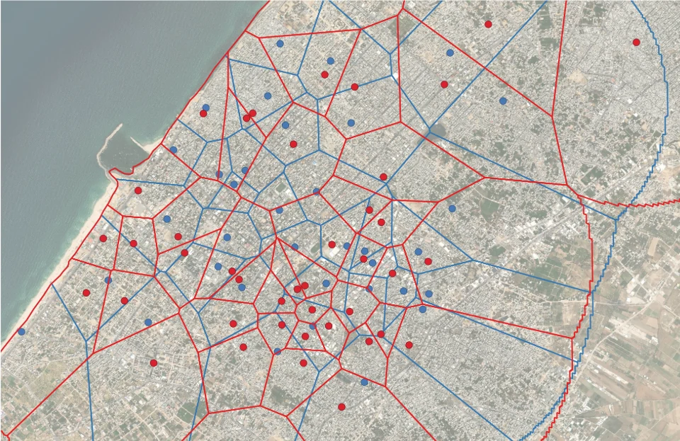
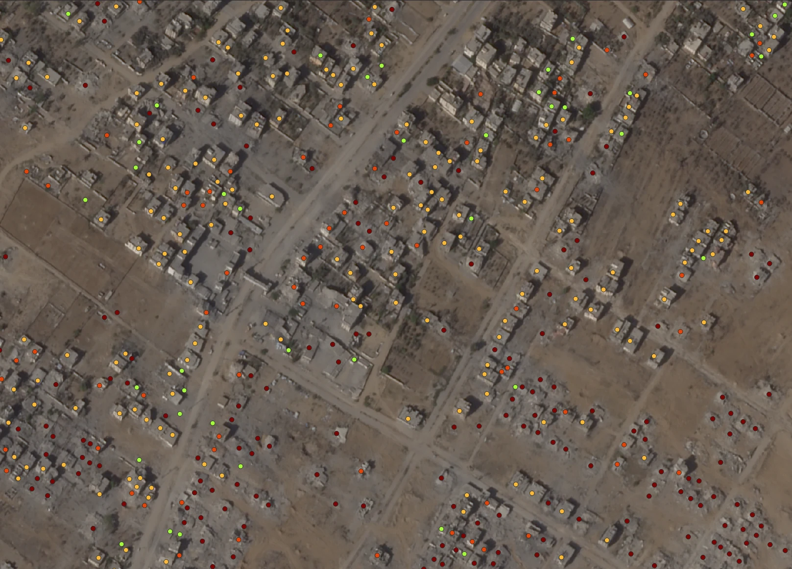
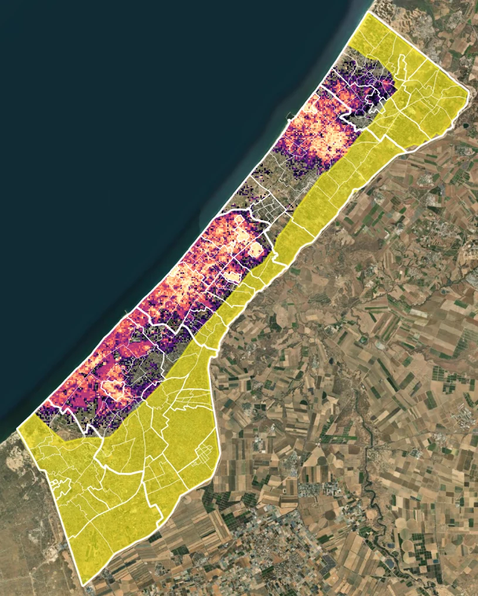
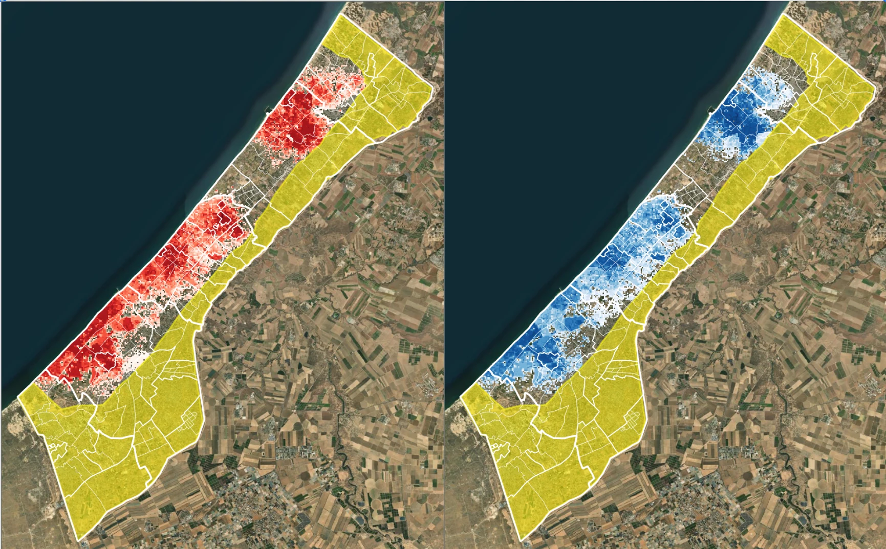
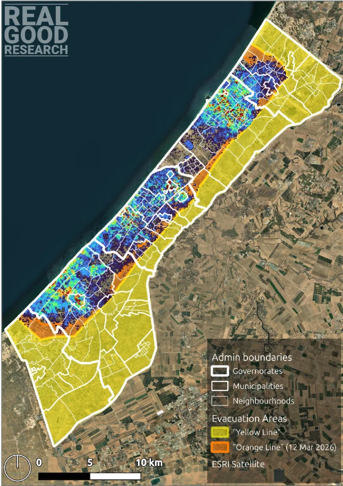
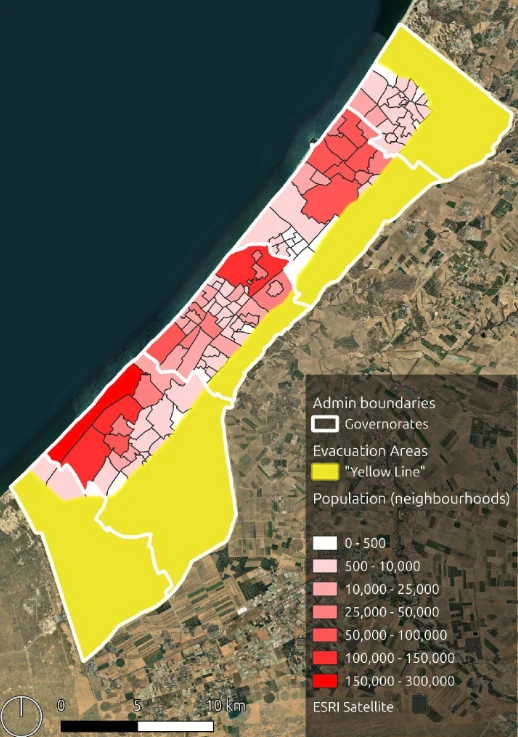

{fig-align="center" width="100%"}

## Introduction 

As we carry our cellphones around in our pockets, they are silently pinging nearby cell towers to maintain a connection with the network. Working with the United Nations Office for Coordination Affairs (UNOCHA) to provide up-to-date demographic data for humanitarian needs assessments, we use anonymised and aggregated counts of users on each tower in the Gaza strip across two mobile phone networks to provide snapshot counts of mobile phone users in the general vicinity of each tower. These data contain no information about individual people or their specific locations. 

**Our goal** is to utilise this information to estimate population sizes on a 100-m grid by incorporating additional information about the locations of tent shelters and undamaged housing units inside buildings. Because these data do not include information about people without cell phones, we need to account for mobile network coverage to scale up from mobile phone users to total population.  

:::{.callout-note}
# Open-source
The source code for this analysis pipeline is publicly available from GitHub with an open-source license: [https://github.com/realgoodresearch/GazaNowPop](https://github.com/realgoodresearch/GazaNowPop).  

Check the `./src/deterministic/` folder with sourcecode for the "deterministic" pipeline described here. Note: We are also pursuing a Bayesian statistical approach in the repository that is not yet production-ready.
:::

## Data

The primary data used in this pipeline are:  

- **Telecommunications** - Aggregated and anonymised counts of active subscribers on each geolocated telecommunications tower from two mobile network operators in the Gaza Strip (UNOCHA, *personal communication*).
- **Housing Units** - Comprehensive building damage assessment from UNOSAT ([UNOSAT 2025](https://unosat.org/products/4213)). 
  - Additional attributes were requested from UNOSAT to represent estimates of undamaged housing units in each building (UNOSAT, *personal communication*).
- **Tents** - Maps of tent point locations have been obtained from two sources depending on the date; 
  - Real Good Research [TentNetFA](https://github.com/realgoodresearch/TentNetFA) automated tent mapping (e.g. [Zhang et al. 2026](https://data.realgoodresearch.com/collection.html?slug=gazatents-5aug2026)).
  - UNOSAT manual tent mapping (not publicly available).

Additional data that are utilised include:  

- **Administrative boundaries** - Governorates, municipalities, and neighbourhoods (UNOCHA, *personal communication*) 
- **Yellow-line militarised area** - The boundaries of the IDF-enforced yellow line that excludes civilians from entering (UNOCHA, *personal communication*). We exclude areas behind the yellow line from our analyses.    
- **Evacuation orders** - For dates up to 13 September 2025, we utilised Israeli military displacement orders ([UNOCHA 2025](https://app.powerbi.com/view?r=eyJrIjoiNjY4NzkwMjItYzI2MC00NmQ4LWE2MTktMDQxMjBmMTk5NmIwIiwidCI6IjBmOWUzNWRiLTU0NGYtNGY2MC1iZGNjLTVlYTQxNmU2ZGM3MCIsImMiOjh9)). 

## Analysis

Let's begin with a quick overview of the phases of the analysis pipeline, and then we'll dive into each one in a little more detail. 

We first estimate the geographic area that each telecommunications tower covers. Within each of these catchment areas, we allocate subscribers from the tower into 100-m grid cells based on the availability of shelters in each grid cell. The shelters could be tents or undamaged housing units in buildings. This results in a 100-m grid of subscriber counts for each of the two mobile networks. We combine these subscriber grids and scale up to total population--including the sub-population not active on either network--based on the penetration rates of each mobile network. The calculations of penetration rates assume that the total population size for the Gaza strip is 2.13-million people ([PCBS 2025](https://www.pcbs.gov.ps/en/post-details/?postId=23319)), and our population estimates always sum up to match this number.


### Tower catchment areas

We do not know the exact coverage area of each telecommunications tower. We implement a very simple approach to approximate tower catchment areas by assuming that each phone connects to the nearest tower within 2-km. We chose 2-km as a rough estimate of the maximum coverage radius for a 2G tower. Estimating tower catchment areas could include significant detail including signal attenuation curves, effects of topography, and buildings. However, this is not required for our purposes, and we did not have sufficient information to build a well parameterised coverage model.

We use Voronoi polygons with a 2-km clip radius to enforece a maximum signal distance. We calculate these simple tower catchment areas separately for each mobile network (@fig-tower-catchments). 

{#fig-tower-catchments fig-align="center" width="100%" .lightbox}

We have a count of users on each tower, and we assume that they are located somewhere within the catchment polygon. Our next objective is to logically distribute users among potential locations *within* each tower catchment area. 

### Available dwellings

Mobile phone users that have been counted on a tower are likely to be located in a building or tent within the tower's catchment area. Our next step is to quantify tents and undamaged housing units within 100-m grid cells to help us allocate users from a tower into grid cells within its catchment area.

#### Tents

We use a map of tent locations covering the Gaza strip. UNOSAT has produced manually validated tent maps for some dates, but for other dates we use our own automated tent maps extracted from Planet Labs satellite imagery using the open-source [TentNetFA](https://github.com/realgoodresearch/TentNetFA) algorithm (@fig-tent-slider).

```{r}
#| echo: false
#| results: asis

figure_id <- "fig-tent-slider"
widget_id <- paste0("slider-", sub("^fig-", "", figure_id))
img_a_uri <- "resources/gaza-nowpop-telecoms/fig-tent-point-slider-A.jpg"
img_b_uri <- "resources/gaza-nowpop-telecoms/fig-tent-point-slider-B.jpg"

widget <- htmltools::tagList(
  htmltools::tags$style(htmltools::HTML(sprintf(
    "#%1$s-wrap {
  max-width: 900px;
  margin: 1rem auto;
}

#%1$s-compare {
  position: relative;
  width: 100%%;
  aspect-ratio: 16 / 9;
  overflow: hidden;
  border-radius: 8px;
  cursor: ew-resize;
  touch-action: none;
  user-select: none;
}

#%1$s-compare img {
  position: absolute;
  inset: 0;
  width: 100%%;
  height: 100%%;
  object-fit: cover;
  display: block;
  pointer-events: none;
}

#%1$s-overlay {
  clip-path: inset(0 50%% 0 0);
}

#%1$s-handle {
  position: absolute;
  top: 0;
  bottom: 0;
  left: 50%%;
  width: 2px;
  background: rgba(255, 255, 255, 0.95);
  box-shadow: 0 0 0 1px rgba(0,0,0,0.35);
  pointer-events: none;
}

#%1$s-handle::after {
  content: '';
  position: absolute;
  top: 50%%;
  left: 50%%;
  transform: translate(-50%%, -50%%);
  width: 28px;
  height: 28px;
  border-radius: 50%%;
  background: rgba(255, 255, 255, 0.95);
  box-shadow: 0 0 0 1px rgba(0,0,0,0.35);
}

/* Fullscreen button */

#%1$s-fullscreen {
  position: absolute;
  top: 12px;
  right: 12px;
  z-index: 10;
  padding: 6px 12px;
  background: rgba(0, 0, 0, 0.65);
  color: white;
  border: none;
  border-radius: 5px;
  cursor: pointer;
  font-size: 22px;
  line-height: 1;
  transition: background 0.2s ease;
}

#%1$s-fullscreen:hover {
  background: rgba(0, 0, 0, 0.85);
}

/* Fullscreen layout */

#%1$s-compare:fullscreen {
  width: 100vw;
  height: 100vh;
  aspect-ratio: auto;
  border-radius: 0;
  background: #111;
}

#%1$s-compare:fullscreen img {
  object-fit: contain;
}

#%1$s-compare:fullscreen # %1$s-fullscreen {
  top: 20px;
  right: 20px;
}",
    widget_id
  ))),

  htmltools::tags$div(
    id = paste0(widget_id, "-wrap"),

    htmltools::tags$div(
      id = paste0(widget_id, "-compare"),

      htmltools::tags$img(
        src = img_a_uri,
        alt = "Satellite image only"
      ),

      htmltools::tags$img(
        id = paste0(widget_id, "-overlay"),
        src = img_b_uri,
        alt = "Satellite image with tent points"
      ),

      htmltools::tags$div(
        id = paste0(widget_id, "-handle")
      ),

      # Fullscreen toggle button
      htmltools::tags$button(
        id = paste0(widget_id, "-fullscreen"),
        type = "button",
        "\u26F6",
        title = "Toggle fullscreen",
        `aria-label` = "Toggle fullscreen"
      )
    )
  ),

  htmltools::tags$script(htmltools::HTML(sprintf(
    "(function() {
  const compare = document.getElementById('%1$s-compare');
  const overlay = document.getElementById('%1$s-overlay');
  const handle = document.getElementById('%1$s-handle');
  const fullscreenBtn = document.getElementById('%1$s-fullscreen');

  let dragging = false;
  let currentPct = 50;

  function updateSlider(pct) {
    currentPct = Math.min(Math.max(pct, 0), 100);

    overlay.style.clipPath =
      `inset(0 ${100 - currentPct}%% 0 0)`;

    handle.style.left = `${currentPct}%%`;
  }

  function setPosition(clientX) {
    const rect = compare.getBoundingClientRect();
    const x = Math.min(
      Math.max(clientX - rect.left, 0),
      rect.width
    );

    const pct = rect.width === 0
      ? 50
      : (x / rect.width) * 100;

    updateSlider(pct);
  }

  compare.addEventListener('pointerdown', function(event) {
    if (event.target === fullscreenBtn) return;

    dragging = true;
    compare.setPointerCapture(event.pointerId);
    setPosition(event.clientX);
  });

  compare.addEventListener('pointermove', function(event) {
    if (dragging) {
      setPosition(event.clientX);
    }
  });

  compare.addEventListener('pointerup', function(event) {
    dragging = false;

    if (compare.hasPointerCapture(event.pointerId)) {
      compare.releasePointerCapture(event.pointerId);
    }
  });

  compare.addEventListener('pointercancel', function(event) {
    dragging = false;

    if (compare.hasPointerCapture(event.pointerId)) {
      compare.releasePointerCapture(event.pointerId);
    }
  });

  compare.addEventListener('pointerleave', function() {
    dragging = false;
  });

  /* Fullscreen controls */

  fullscreenBtn.addEventListener('pointerdown', function(event) {
    event.stopPropagation();
  });

  fullscreenBtn.addEventListener('click', function(event) {
    event.stopPropagation();

    if (document.fullscreenElement === compare) {
      document.exitFullscreen();
    } else {
      compare.requestFullscreen();
    }
  });

  /* Preserve slider position when resizing */

  document.addEventListener('fullscreenchange', function() {
    updateSlider(currentPct);

    fullscreenBtn.title =
      document.fullscreenElement === compare
        ? 'Exit fullscreen'
        : 'Enter fullscreen';

    fullscreenBtn.setAttribute(
      'aria-label',
      fullscreenBtn.title
    );
  });

  window.addEventListener('resize', function() {
    updateSlider(currentPct);
  });

  /* Initialize slider at midpoint */

  updateSlider(50);
})();",
    widget_id
  )))
)

knitr::asis_output(paste0(
  "::: {#",
  figure_id,
  "}\n\n",
  "```{=html}\n",
  htmltools::renderTags(widget)$html,
  "\n```\n\n",
  "Move the slider to show/hide tent points to visually compare ",
  "with the underlying satellite imagery. ",
  "Click the fullscreen button to enlarge the comparison.",
  "\n\n:::\n"
))
```

#### Housing units

Some populations are living inside buildings, and we need to map those available shelter locations as well. The challenge is the widespread destruction of buildings in the Gaza strip. We have relied on the Comprehensive Damage Assessments from UNOSAT ([UNOSAT 2025](https://unosat.org/products/4213); @fig-building-damage) which were appended upon request by UNOSAT with estimates of undamaged housing units in each building. The building locations and original number of housing units are based on the PCBS cadastral registry, which UNOSAT updated based on their satellite-based assessment of building damage.

{#fig-building-damage fig-align="center" width="100%" .lightbox}

#### Dwelling grids
Tents and undamaged housing units are combined into a 100-m grid that includes the count of available dwellings (tents or housing units) in each grid cell (@fig-dwelling-grid).

{#fig-dwelling-grid fig-align="center" width="100%" .lightbox}

### Subscriber grids

We can now allocate users from each tower into dwellings within the catchment area of the tower. This is done by calculating the average number of mobile phone subscribers per available shelter in the catchment area for a tower and then allocating equal numbers of subscribers into each dwelling (@fig-subscriber-grids). This process assumes homogeneous household sizes in every tent and housing unit and that all dwellings are occupied. These assumptions are necessary given the data available and should be taken into account upon interpretation of the results.

{#fig-subscriber-grids fig-align="center" width="100%" .lightbox}

### Population estimation

The subscriber grids count active mobile subscribers, not people. We therefore convert subscriber counts to population estimates while allowing for people without an active phone on either network.

First, we split the study area into cells with coverage from at least one provider and cells with no provider coverage. Let \(T = 2,130,000\) be the assumed total population, \(H\) the number of available dwellings in the covered area, and \(J\) the number in the uncovered area. We use the average number of people per available dwelling,

$$
\phi = \frac{T}{H + J},
$$

to estimate the population in the covered area, $N = H\phi$, and the population outside coverage, $M = J\phi$. This provides the population denominator needed for the mobile-network calculations.

For each provider \(k\), its penetration rate within the covered area is the total number of subscribers allocated to its grid, divided by \(N\):

$$
p_k = \frac{\sum_g S_{k,g}}{N},
$$

where $S_{k,g}$ is the estimated number of active subscribers of provider \(k\) in grid cell \(g\). Intuitively, $p_k$ is the estimated share of people in the covered area who appear as active subscribers on that network. The rates are calculated separately for the two providers.

We then estimate the population of each 100-m grid cell according to which networks cover it. For a cell with no network coverage, we use the dwelling-based estimate. For a cell covered by only provider 1 or only provider 2, we divide that provider's subscriber count by its penetration rate. Where both providers have coverage, we combine their subscriber counts and their penetration rates:

$$
\widehat{P}_g =
\begin{cases}
D_g\phi, & \text{no provider coverage}, \\
S_{1,g}/p_1, & \text{provider 1 only}, \\
S_{2,g}/p_2, & \text{provider 2 only}, \\
\left(S_{1,g} + S_{2,g}\right) / \left(p_1 + p_2\right), & \text{both providers},
\end{cases}
$$

where $D_g$ is the number of available dwellings in 100-m grid cell \(g\). Finally, we rescale every grid-cell estimate by the same factor so that the full population grid sums exactly to \(T\). This corrects small differences introduced by coverage boundaries, missing cells, and raster calculations while preserving the relative pattern of the estimates.

#### Population per dwelling type

To separate the resulting population into people living in tents and people living in buildings, we calculate a cell-specific average household size:

$$
h_g = \frac{\widehat{P}_g}{A_g + B_g},
$$

where $A_g$ is the number of tents and $B_g$ is the number of undamaged housing units in buildings. The corresponding estimates are

$$
\widehat{P}^{\mathrm{tent}}_g = A_g h_g
\qquad \text{and} \qquad
\widehat{P}^{\mathrm{building}}_g = B_g h_g.
$$

By construction, these two estimates sum to the total population estimate in each cell.

This approach makes several explicit assumptions:

- Every available tent and undamaged housing unit is occupied.
- Within a cell, tents and housing units have the same average household size.
- The penetration rate for each provider is constant throughout its coverage area.
- Subscriber counts from the two providers represent distinct network memberships; the combined-rate calculation does not correct for people who hold active subscriptions on both networks.
- The assumed Gaza-wide total population of 2.13 million is correct for the reference date.

At this point, we have population estimates on a 100-m grid for every grid cell with available dwellings according to our tent and building maps, excluding areas within the yellow line exclusion zone.

{#fig-gridded-population-estimates fig-align="center" width="75%" .lightbox}


### Aggregation

The 100-m gridded population estimates are primarily intended as a geographical unit of analysis to facilitate flexibility aggregating population estimates for larger areas. Due to the various assumptions that we have highlighted, we do not expect the population estimates to be precise at the level of individual 100-m grid cells. We expect the estimates to be more reliable at larger aggregated spatial scales. We provide such aggregations for neighbourhoods (@fig-pop-nbr), municipalities, and governorates. We also provide the 100-m gridded estimates so that partners can aggregate to other spatial units (e.g. site boundaries or healthcare catchment areas). 

{#fig-pop-nbr fig-align="center" width="75%" .lightbox}

## Triangulation

There are no reliable validation datasets available for assessing accuracy of these population estimates. The best that we can do is to triangulate the estimates with other sources of information from the field. This is coordinated through partnerships with UNOCHA and the Site Management Cluster. When discrepencies are found, we investigate the underlying causes and work to improve the methodology through these investigations. 

We have experimented with a Bayesian statistical approach that could replace the deterministic estimation described here. One advantage (out of many) of a statistical approach is the ability to conduct out-of-sample cross-validation in which telecommunications data could be witheld from model fitting and used to assess prediction accuracy. The deterministic approach described here is ideal for rapid-response operational population estimation, while we continue to pursue a robust statistical method suitable for this data landscape in parallel.

## Assumptions and Limitations

- We assume that mobile phones connect to the nearest tower within 2-km rather than pursuing a more advanced tower coverage model.  
- Our automated tent maps (and even manually-produced tent maps) are known to include errors (i.e. false positive and false negatives). We are working on pipelines to efficiently generate validation and training data for continuous improvements.  
- We assume that every available tent and undamaged housing unit is occupied, although some at very low population densities.
- Within a cell, we assume that tents and housing units have the same average household size, but this household size can vary among cells.
- The penetration rate for each provider is assumed to be constant throughout its coverage area, which is necessary without additional information.
- Subscriber counts from the two providers represent distinct network memberships; we do not correct for people who hold active subscriptions on both networks.
- The assumed Gaza-wide total population of 2.13 million is correct for the reference date.
