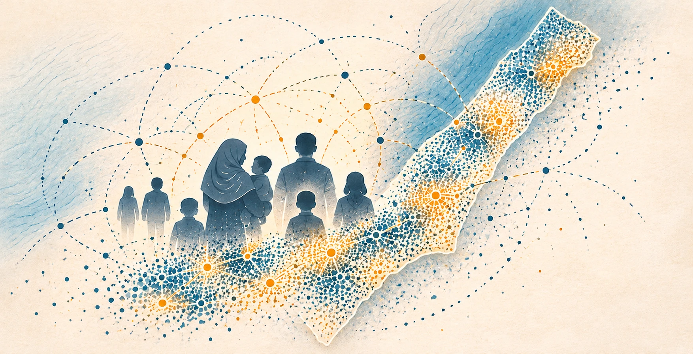

{fig-align="center" width="75%"}

We contribute to international humanitarian response using digital traces and remote sensing for population nowcasting--near real-time population estimation.

Our work in this area began in the immediate aftermath of the large-scale Russian invasion of Ukraine on the 22 February 2022 when we teamed up with the UN International Organization for Migration to repurpose targeted advertising data from social media into a tool for targeted humanitarian aid ([Leasure et al. 2023](https://doi.org/10.1111/padr.12558)). We later transferred these approaches to Gaza supporting the UN Office for Coordination of Humanitarian Affairs and the Site Management Cluster (Acted and IOM). You can read about some of our early work for Gaza from [Darin et al. (2026)](https://doi.org/10.1111/padr.70064) that further developed these methods and data to provide a generalised toolbox for digital traces in crisis response.

Since our initial work with social media targeted advertising data in Ukraine and Gaza, the data landscape has unsurprisingly changed in both of these crises, and we have been continuously working on methods that can help the humanitarian responses adapt to these changes. This has included Bayesian mark-recapture methods to leverage polio vaccination data for estimation of child population sizes and vaccine coverage in Gaza, using Vodafone advertising data to estimate internal (sub-national) population flows in Ukraine, demographic indirect estimation using privacy-preserving telecommunications data for population nowcasting, and machine learning for automated tent mapping from satellite imagery. 

Our aim with this collection of tutorials and documentation is to make these methods more accessible to you. We will walk you through some of the details and provide the source code so that you can reproduce and adapt the methods yourself. This is part of our vision for open-source innovation for humanitarian population nowcasting so that science can be harnessed and adapted more quickly to respond to crisis events. We hope you find these materials useful in your own work and that we can grow the community of researchers working together to improve these approaches.
