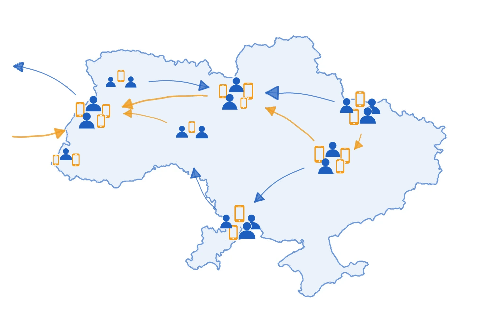
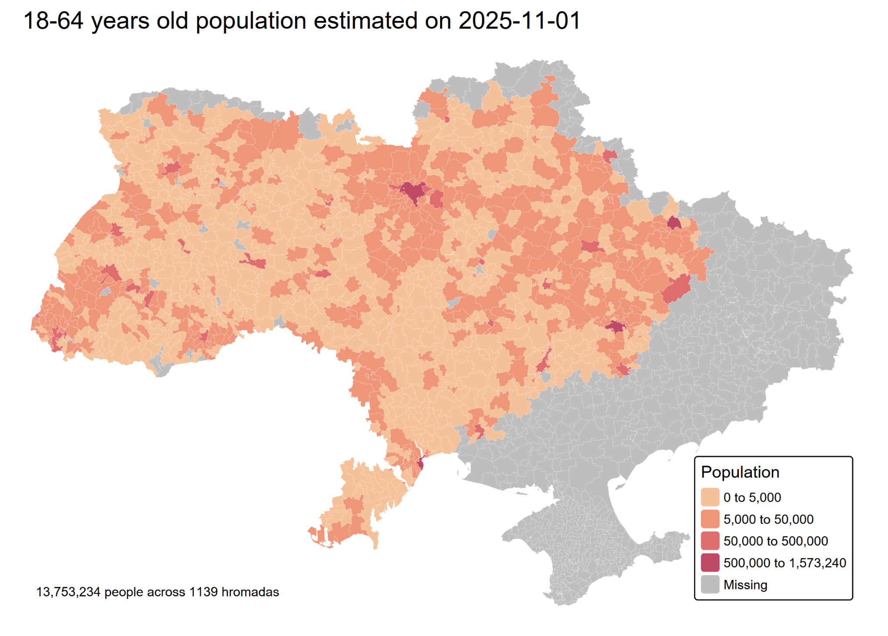
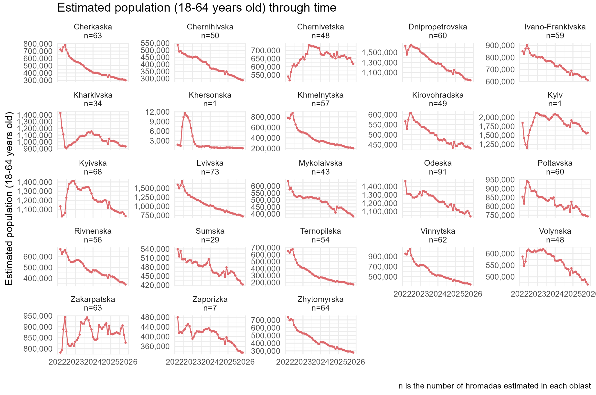
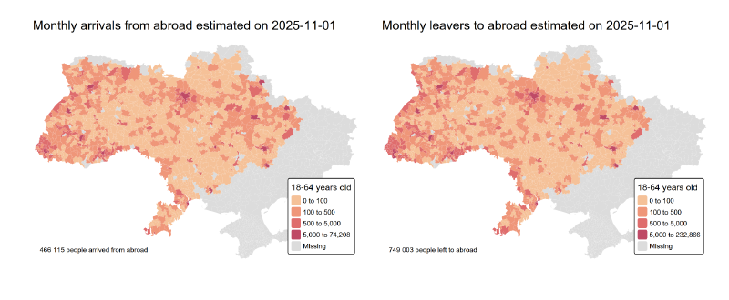
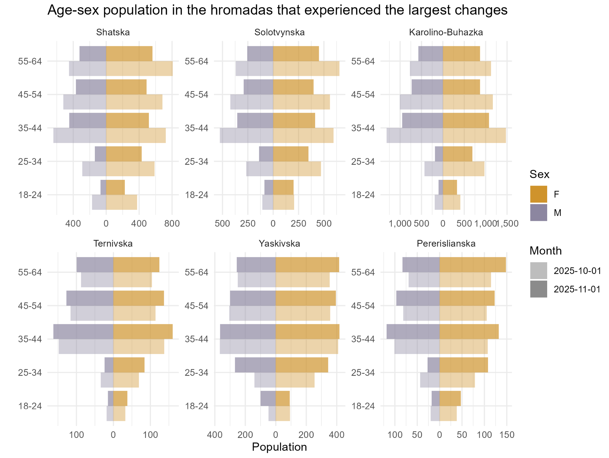
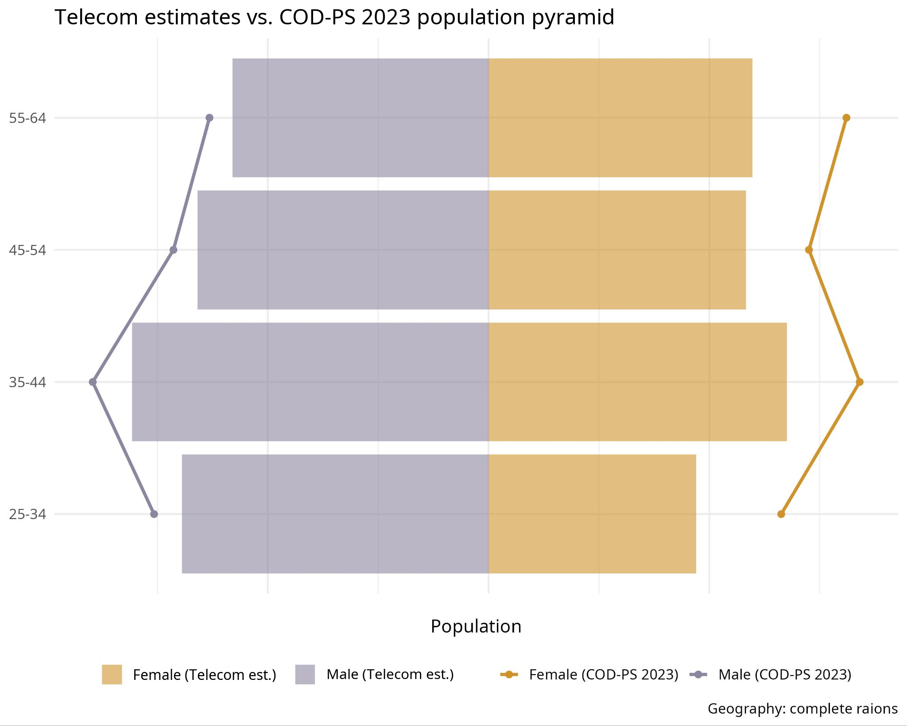

{fig-align="center" width="100%"}

## Introduction

Since the full-scale Russian invasion of Ukraine in February 2022, millions of people have left the country, moved within it, and, increasingly, returned. Humanitarian planning needs up-to-date answers to three questions: how many people live in each community now, who they are by age and sex, and where they have come from. Ukraine has had no census since 2001, and conventional population estimates cannot keep pace with displacement on this scale.

Mobile networks observe these movements continuously. Unlike our [Gaza NowPop](gaza-nowpop-telecoms.qmd) work, which uses counts of users connected to individual cell towers, here we use a commercial data product: aggregated statistics that a mobile network operator in Ukraine produces for targeted marketing purposes and makes available for purchase. Using an off-the-shelf data product has practical advantages: it can be bought through a standard commercial process, it arrives already aggregated at administrative level, and it comes in a regular format with age and sex. The trade-off is that we cannot control how the aggregates are produced, and that keeping estimates up to date means continuing to buy data updates.

Telecom advertising data were not our first exercise. Our earlier nowcasts for Ukraine used social media advertising audience counts from Meta ([Leasure et al. 2023](https://doi.org/10.1111/padr.12558)), but a change to Meta's Marketing API in May 2024 made those data unsuitable on their own for real-time nowcasting. We therefore moved to telecom advertising data, which offered something new: as well as counting subscribers in each place, they record, for each pair of locations, how many subscribers moved between locations. These monthly flows let us better track how the share of residents on the network, the *penetration rate*, changes over time and space as people move.

**Our modelling goal** is to convert monthly subscriber flows into monthly population estimates and population flows for each hromada (Ukraine's basic municipal unit), by age group and sex, consistent with the national population after accounting for people who have crossed the border.

This work was undertaken at the Demographic Science Unit, University of Oxford, in partnership with the World Health Organization (WHO) Ukraine.

::: callout-note
# Open-source

The source code for this analysis pipeline is publicly available from GitHub with an open-source license (GPL-3.0): <https://github.com/OxfordDemSci/UkraineNowPop>.

The method described here is in the `./src/analysis/` folder, and the data preparation in `./src/data_prep/`.
:::

## Data

The primary data used in this pipeline are:

-   **Telecom subscribers flows** - A commercial data product from a mobile phone company in Ukraine, designed for advertising, giving aggregated monthly counts of subscribers by age group and sex. A subscriber's *home* hromada is their most common night-time location over the previous three months. We use three of the product's tables:

    -   *Monthly flows*: subscribers whose home hromada last month was $i$ and whose current home hromada is $j$. Besides hromadas, origins can be *Abroad* (subscribers returning from outside Ukraine) or *Unknown* (subscribers whose previous location is not known, such as new subscribers), and destinations can be *Abroad*. Monthly flows are only available for government-controlled territory (GCT).
    -   *Baseline flows*: subscribers whose home hromada in January 2022 was $i$ and whose current home hromada is $j$. We use them to account for non-government-controlled territory (NGCT) (see Step 3).
    -   *Stocks*: subscribers whose home is in each hromada.

    Our estimates cover February 2022 to November 2025 for the 18 to 64 years old.

-   **Baseline population** - Total population of each hromada in 2022 from the State Statistics Service of Ukraine ([SSSU](https://www.ukrstat.gov.ua)).

-   **Baseline age-sex structure** - Population by age and sex for each oblast (region) on 1 January 2022, from the Common Operational Dataset on Population Statistics (COD-PS) for Ukraine ([UNFPA, HDX](https://data.humdata.org/dataset/cod-ps-ukr)).

-   **Border crossings** - Counts of people leaving and entering Ukraine, recorded by the border authorities and published by UNHCR: daily until December 2024, then monthly ([UNHCR Operational Data Portal](https://data.unhcr.org/en/situations/ukraine)).

-   **Age-sex profile of people leaving** - Ukrainians with temporary protection status in neighbouring countries (Hungary, Moldova, Poland, Romania, and Slovakia), by age and sex ([Eurostat](https://ec.europa.eu/eurostat/cache/metadata/en/migr_asytp_esms.htm)).

-   **Age-sex profile of people returning** - Profiles of returnees from the International Organization for Migration (IOM) Displacement Tracking Matrix (DTM) *Crossing back* surveys ([IOM DTM](https://dtm.iom.int/online-interactive-resources/ukraine-regional-response-dashboard/index.html?category=Demographic%20Profile&survey=crossings)). These surveys stopped in December 2024.

Additional data that are used include:

-   **Administrative boundaries** - Oblasts, raions (districts), and hromadas with their P-codes from the Common Operational Dataset on Administrative Boundaries (COD-AB) ([OCHA, HDX](https://data.humdata.org/dataset/cod-ab-ukr)). We also group oblasts into macroregions.
-   **Areas outside government control** - We follow the telecom operator's own classification which is fixed over time.

## Analysis

### Data preparation

Some hromadas are missing from the monthly flows for some months. If a hromada is missing for three or fewer consecutive months, we fill the gap by repeating the flows into it from the last month observed before the gap. Hromadas missing for more than three consecutive months are excluded, both as origins and as destinations. 3 hromadas were imputed in this way, and 1,138 hromadas were included in the estimates.

### Overview

The pipeline runs month by month. In outline (@fig-model-schema):

1.  **Population totals.** For each hromada, we measure the *penetration rate*: the number of the operator's subscribers per resident. We estimate it at the start of the series, before the full-scale invasion, using the 2022 baseline population. We use it to turn each month's subscriber flows into population flows, and then update it from the newly estimated population.
2.  **Age and sex.** We repeat the same logic separately for each age-sex group, at the coarser level of macroregions, where data are more complete. We use the result to split each hromada flow by age and sex.
3.  **National consistency.** We rescale the estimates so that, for each age-sex group, they match the national population after accounting for cumulative border crossings and the population in non-government-controlled territory (NGCT). This also allows to take into accout change in penetration rate that are affecting uniformly the country.

Summing the estimated flows by destination gives the population of each hromada at each month.

::: {#fig-model-schema}
```{=html}
<svg viewBox="0 0 900 420" role="img" aria-label="Model schema. Columns: abroad, government-controlled territory with telecom monthly flows between hromadas, and non-government-controlled territory. Rows under each column list the telecom data, other data, and estimated quantities. Below, the national total receives border crossings and the NGCT population and rescales the government-controlled estimates." style="width:100%; max-width:900px; height:auto; display:block; margin:1rem auto; font-family:inherit; font-size:13px;">
  <defs>
    <marker id="ua-t" viewBox="0 0 10 10" refX="9" refY="5" markerWidth="7" markerHeight="7" orient="auto-start-reverse"><path d="M0,0 L10,5 L0,10 z" fill="#0072B2"/></marker>
    <marker id="ua-o" viewBox="0 0 10 10" refX="9" refY="5" markerWidth="7" markerHeight="7" orient="auto-start-reverse"><path d="M0,0 L10,5 L0,10 z" fill="#00795A"/></marker>
    <marker id="ua-e" viewBox="0 0 10 10" refX="9" refY="5" markerWidth="7" markerHeight="7" orient="auto-start-reverse"><path d="M0,0 L10,5 L0,10 z" fill="#B84F00"/></marker>
    <marker id="ua-g" viewBox="0 0 10 10" refX="9" refY="5" markerWidth="6" markerHeight="6" orient="auto-start-reverse"><path d="M0,0 L10,5 L0,10 z" fill="#5b6675"/></marker>
    <marker id="ua-e2" viewBox="0 0 10 10" refX="9" refY="5" markerWidth="3.5" markerHeight="3.5" orient="auto-start-reverse"><path d="M0,0 L10,5 L0,10 z" fill="#B84F00"/></marker>
  </defs>

  <!-- Areas -->
  <rect x="110" y="45" width="130" height="235" rx="10" fill="#f5f6f8" stroke="#9aa5b4"/>
  <rect x="290" y="10" width="370" height="270" rx="10" fill="#f5f6f8" stroke="#9aa5b4"/>
  <rect x="710" y="45" width="180" height="235" rx="10" fill="#f5f6f8" stroke="#9aa5b4"/>
  <text x="175" y="70" text-anchor="middle" font-weight="bold" font-size="14" fill="#1f2933">Abroad</text>
  <text x="475" y="36" text-anchor="middle" font-weight="bold" font-size="14" fill="#1f2933">Government-controlled</text>
  <text x="800" y="66" text-anchor="middle" font-weight="bold" font-size="14" fill="#1f2933">Non-government-</text>
  <text x="800" y="83" text-anchor="middle" font-weight="bold" font-size="14" fill="#1f2933">controlled</text>

  <!-- GCT: hromadas with monthly flows -->
  <circle cx="375" cy="95" r="20" fill="#fff" stroke="#9aa5b4" stroke-width="1.5"/>
  <circle cx="575" cy="80" r="20" fill="#fff" stroke="#9aa5b4" stroke-width="1.5"/>
  <circle cx="475" cy="150" r="20" fill="#fff" stroke="#9aa5b4" stroke-width="1.5"/>
  <line x1="400" y1="93" x2="548" y2="82" stroke="#0072B2" stroke-width="1" marker-end="url(#ua-t)"/>
  <line x1="555" y1="94" x2="497" y2="135" stroke="#0072B2" stroke-width="1" marker-end="url(#ua-t)"/>
  <line x1="453" y1="138" x2="399" y2="108" stroke="#0072B2" stroke-width="1" marker-end="url(#ua-t)"/>
  <text x="575" y="118" text-anchor="middle" font-size="12" font-style="italic" fill="#5b6675">hromadas</text>
  <path d="M465,172 C452,202 498,202 485,173" fill="none" stroke="#0072B2" stroke-width="1" marker-end="url(#ua-t)"/>

  <!-- NGCT: one area -->
  <circle cx="800" cy="135" r="30" fill="#fff" stroke="#9aa5b4" stroke-width="1.5"/>

  <!-- Abroad: one area, flows to and from hromadas -->
  <circle cx="175" cy="135" r="30" fill="#fff" stroke="#9aa5b4" stroke-width="1.5"/>
  <line x1="209" y1="128" x2="349" y2="100" stroke="#0072B2" stroke-width="1" marker-end="url(#ua-t)"/>
  <line x1="450" y1="149" x2="212" y2="137" stroke="#0072B2" stroke-width="1" marker-end="url(#ua-t)"/>

  <!-- NGCT -> GCT: leavers join government-controlled territory, destination hromada unknown -->
  <line x1="764" y1="135" x2="666" y2="135" stroke="#0072B2" stroke-width="1" marker-end="url(#ua-t)"/>

  <!-- Separators between diagram and rows -->
  <line x1="120" y1="205" x2="230" y2="205" stroke="#9aa5b4" stroke-dasharray="3 3"/>
  <line x1="300" y1="205" x2="650" y2="205" stroke="#9aa5b4" stroke-dasharray="3 3"/>
  <line x1="720" y1="205" x2="880" y2="205" stroke="#9aa5b4" stroke-dasharray="3 3"/>

  <!-- Rows: telecom data, other data, estimated -->
  <text x="12" y="222" font-weight="bold" font-size="12" fill="#0072B2">Telecom data</text>
  <text x="175" y="222" text-anchor="middle" fill="#0072B2">monthly flows</text>
  <text x="475" y="222" text-anchor="middle" fill="#0072B2">monthly flows</text>
  <text x="800" y="222" text-anchor="middle" fill="#0072B2">stock, baseline flows</text>
  <text x="12" y="244" font-weight="bold" font-size="12" fill="#00795A">Other data</text>
  <text x="175" y="244" text-anchor="middle" fill="#00795A">crossings</text>
  <text x="475" y="244" text-anchor="middle" fill="#00795A">2022 baseline</text>
  <text x="800" y="244" text-anchor="middle" fill="#00795A">2022 baseline</text>
  <text x="12" y="266" font-weight="bold" font-size="12" fill="#B84F00">Penetration rate</text>
  <text x="175" y="266" text-anchor="middle" fill="#B84F00">reset monthly</text>
  <text x="475" y="266" text-anchor="middle" fill="#B84F00">updated monthly</text>
  <text x="800" y="266" text-anchor="middle" fill="#B84F00">fixed (pre-invasion)</text>

  <!-- Role of the national total -->
  <line x1="800" y1="286" x2="800" y2="324" stroke="#B84F00" stroke-width="1" marker-end="url(#ua-e)"/>
  <text x="808" y="309" font-size="12" fill="#B84F00">− NGCT</text>
  <line x1="475" y1="325" x2="475" y2="288" stroke="#B84F00" stroke-width="3" marker-end="url(#ua-e2)"/>
  <text x="487" y="309" font-size="12" font-weight="bold" fill="#B84F00">calibrates population</text>

  <rect x="110" y="330" width="780" height="56" rx="10" fill="#f5f6f8" stroke="#9aa5b4"/>
  <text x="500" y="363" text-anchor="middle" font-weight="bold" font-size="14"><tspan fill="#B84F00">National total</tspan><tspan fill="#1f2933"> = </tspan><tspan fill="#00795A">2022 baseline ± border crossings</tspan><tspan fill="#1f2933"> − </tspan><tspan fill="#B84F00">NGCT population</tspan></text>

  <text x="500" y="410" text-anchor="middle" font-size="12"><tspan fill="#00795A">Other data: SSSU, COD-PS, UNHCR, Eurostat, IOM</tspan><tspan fill="#5b6675">   ·   </tspan><tspan fill="#B84F00">Orange: estimated by the model</tspan></text>
</svg>
```

Overview of the model.
:::

### Notation

| Indices | Data | Parameters |
|------------------------|------------------------|------------------------|
| $i$, $j$: origin and destination hromada (or *Abroad*, *Unknown*) | $S$: subscriber monthly flows | $p$: penetration rate |
| $m$: macroregion ($m_i$: of hromada $i$) | $S^{BF}$, $S^{\text{stock}}$: subscriber baseline flows and stocks | $\pi$: age-sex proportion of flows |
| $o_i$: oblast of hromada $i$ | $T^C$: baseline (2022) population | $\dot N$: intermediate population estimate |
| $a$, $s$: age group and sex | $\pi^O$: baseline age-sex proportion (COD-PS) | $\theta$: national scaling factor |
| $t$: month; $t_0$: first month | $BC$: border crossings (UNHCR) | $T^{GCT}$: national population in government-controlled territory |
| $in$, $out$: inflows and outflows | $\pi^E$, $\pi^{DTM}$: age-sex profiles of leavers (Eurostat) and returnees (IOM DTM) | $N$: final population estimate |

The first month, $t_0$, is February 2022, which reflects home locations before the full-scale invasion. The baseline population by age and sex, $T^C_{t_0,i,a,s}$, is the 2022 total population of hromada $i$ multiplied by the age-sex proportion $\pi^O_{t_0,o_i,a,s}$ of its oblast; $T^C_{t_0,i} = \sum_{a,s} T^C_{t_0,i,a,s}$ is its sum over the age-sex groups covered by the model (18 to 64).

### Step 1: Population flows

#### Initial penetration rate

At $t_0$, the penetration rate of hromada $i$ is the number of subscribers whose flows start there, divided by its baseline population:

$$
p_{t_0,i} = \frac{\sum_j S_{t_0,i,j}}{T^C_{t_0,i}}.
$$

The penetration rate captures the operator's local market share and any differences between subscribers and residents, such as people with more than one SIM card or no phone. Rates are not capped, so a hromada can have more subscribers than residents.

#### From subscriber flows to population flows

Each month, we divide subscriber flows by the penetration rate of the place they came from, using the rate estimated for the previous month:

$$
\dot N_{t,i,j} =
\begin{cases}
\dfrac{S_{t,i,j}}{p_{t-1,i}}, & \text{origin } i \text{ is a hromada}, \\[2ex]
\dfrac{S_{t,\text{unknown},j}}{p_{t-1,j}}, & \text{origin } i \text{ is Unknown}, \\[2ex]
S_{t,\text{abroad},j}\,\dfrac{BC^{in}_t}{\sum_{j} S_{t,\text{abroad},j}}, & \text{origin }i \text{ is Abroad}.
\end{cases}
$$

Subscribers from an unknown origin take the penetration rate of their destination; if they are going abroad, they take the mean penetration rate. Subscribers arriving from abroad are calibrated directly to the border crossing data: their total equals the number of people recorded entering Ukraine that month, distributed across destinations in proportion to the operator's returning subscribers. Unlike hromada penetration rates, which are updated from the previous month's estimates, the rate for arrivals from abroad is reset each month from that month's border entries.

#### Updating the penetration rate

Penetration rates change over time because people move, and because the operator's market share among people who moved can differ from that of people who stayed. After rescaling (Step 3), we update each hromada's penetration rate as the ratio between the subscribers who were in it and the estimated population there:

$$
p_{t,j} = \frac{\sum_i S_{t,i,j}}{\sum_i N_{t,i,j}}.
$$

This rate is used as the origin penetration rate for flows leaving hromada $j$ in the following month.

### Step 2: Age and sex

Subscriber counts by age and sex are sparse at the hromada level: many age-sex groups have no recorded flows between particular hromadas. We therefore estimate age-sex penetration rates for macroregions:

$$
p_{t_0,m,a,s} = \frac{\sum_{i \in m} \sum_j S_{t_0,i,j,a,s}}{\sum_{i \in m} T^C_{t_0,i,a,s}},
$$

For each month, we compute age-sex specific intermediate flows $S_{t,i,j,a,s} / p_{t-1,m_i,a,s}$, and from these the age-sex composition $\pi_{t,a,s}$ of the flows between each pair of origin and destination macroregions. We then split each hromada-level flow from Step 1 according to that composition:

$$
\dot N_{t,i,j,a,s} = \pi_{t,a,s, m_i, m_j}\; \dot N_{t,i,j}.
$$

The total size of each flow therefore comes from the hromada-level penetration rates, while its age-sex composition comes from the macroregion-level rates. For flows from abroad, the age-sex rates are calibrated to border crossings by age and sex (see below). After rescaling, the macroregion age-sex penetration rates are updated in the same way as in Step 1:

$$
p_{t,m,a,s} = \frac{\sum_{j \in m} \sum_i S_{t,i,j,a,s}}{\sum_{j \in m} \sum_i N_{t,i,j,a,s}}.
$$

### Step 3: Rescaling to national totals

Step 3 anchor the estimates to an independent national total, built from the baseline population and border crossings, and use the subscriber data ultimately to distribute it across hromadas.

#### Border crossings by age and sex

Border crossing counts are not broken down by age or sex. We apply the age-sex profile of people under temporary protection in the European Union to departures, and the IOM DTM returnee profile to arrivals:

$$
BC^{out}_{t,a,s} = BC^{out}_t\, \pi^E_{t,a,s},
\qquad
BC^{in}_{t,a,s} = BC^{in}_t\, \pi^{DTM}_{t,a,s}.
$$

The DTM profile uses a broad adult age band; we split it into the model's age groups using the Eurostat age distribution. When the latest month of border crossing or Eurostat data is not yet available, we carry the most recent values forward.

#### Population in non-government-controlled territory

The telecom data have limited coverage in non-government-controlled territory: we have only monthly baseline flows which is the number of people that used to be in the NGCT, that are now in the GCT. We estimate the number of subscribers who remain in NGCT as the NGCT subscriber stock minus the baseline flows of subscribers who have left NGCT since before the full-scale invasion:

$$
S_{t,\text{NGCT},\text{NGCT},a,s} = S^{\text{stock}}_{t_0,\text{NGCT},a,s} - S^{BF}_{t,\text{NGCT}, \text{GCT},a,s}.
$$

We convert this to population using the penetration rate at $t_0$, which we hold constant:

$$
p_{t_0,\text{NGCT},a,s} = \frac{S^{\text{stock}}_{t_0,\text{NGCT},a,s}}{\sum_{i \in \text{NGCT}} T^C_{t_0,i,a,s}},
\qquad
N_{t,\text{NGCT},a,s} = \frac{S_{t,\text{NGCT},\text{NGCT},a,s}}{p_{t_0,\text{NGCT},a,s}}.
$$

These estimates are important to correct the national total used to calibrate the population estimates in the government controlled territory.

#### National totals and scaling factor

For each age-sex group, the national total in government-controlled territory is the baseline population, minus everyone who has left Ukraine since $t_0$, plus everyone who has returned, minus the population in non-government-controlled territory:

$$
T^{\text{GCT}}_{t,a,s} = \sum_i T^C_{t_0,i,a,s} \;-\; \sum_{\tau \le t} BC^{out}_{\tau,a,s} \;+\; \sum_{\tau \le t} BC^{in}_{\tau,a,s} \;-\; N_{t,\text{NGCT},\text{NGCT},a,s},
$$

where the baseline sum covers the hromadas in the telecom data and in non-government-controlled territory.

The domestic flows (from one hromada to another) should add up to this total, except for this month's border crossings, which are represented separately by the flows to and from *Abroad*. The scaling factor is therefore:

$$
\theta^{-1}_{t,a,s} = \frac{\sum_{i \ne \text{abroad}} \sum_{j \ne \text{abroad}} \dot N_{t,i,j,a,s}}{T^{\text{GCT}}_{t,a,s}}.
$$

The final flows are:

$$
N_{t,i,j,a,s} =
\begin{cases}
\dot N_{t,i,j,a,s}\; \theta_{t,a,s}, & i, j \ne \text{abroad}, \\[1ex]
\dot N_{t,i,\text{abroad},a,s}\; \dfrac{BC^{out}_{t,a,s}}{\sum_{i} \dot N_{t,i,\text{abroad},a,s}}, & j = \text{abroad}, \\[2ex]
\dot N_{t,\text{abroad},j,a,s}, & i = \text{abroad}.
\end{cases}
$$

Flows to *Abroad* are rescaled so that they sum to the number of people recorded leaving Ukraine that month. Flows from *Abroad* are already calibrated to arrivals and are not rescaled. Subscribers recorded as moving from abroad to abroad are dropped, because they cannot be calibrated.

Putting the three steps together, each domestic estimate is a subscriber count multiplied by an inverse penetration rate, an age-sex proportion, and a national scaling factor:

$$
N_{t,i,j,a,s} = S_{t,i,j}\; p^{-1}_{t-1,i}\; \pi_{t,a,s, m_i,m_j}\; \theta_{t,a,s}.
$$

### Outputs

#### Population count at hromada level

The population of hromada $j$ in month $t$ is the sum of all flows arriving there:

$$
N_{t,j,a,s} = \sum_i N_{t,i,j,a,s}.
$$



#### Population monthly timeserie from February 2022 to November 2025



#### Population from and to abroad



#### Age and sex compositional shift



We release one pair of CSV files per month:

-   **Population stocks** - estimated population in each hromada.
-   **Population flows** - estimated number of people whose home was in one hromada last month and in another (or the same) hromada this month, including flows to and from *Abroad* and from *Unknown* origins.

Each row identifies the hromada, raion, and oblast by COD P-code, with names in English and Ukrainian. Columns give estimates for each sex (`F`, `M`, or total `T`) and age group (`18_24`, `25_34`, `35_44`, `45_54`, `55_64`, or all adults `18_64`); for example, `F_18_24` holds women aged 18 to 24.

As with any small-area estimate, individual hromada figures are less reliable than aggregates. We recommend aggregating to raions or oblasts where possible.

The estimates are classified as restricted with moderate sensitivity, following the OCHA Information Sharing Protocol for Ukraine. They can be explored in the [Ukraine NowPop dashboard](https://ukraine.nowpop.org), which shows population estimates for a chosen month, age-sex group, and geographic level, as well as flows between areas. Oblast-level results are public; raion- and hromada-level results require user authentication.

## Triangulation

There is no complete, independent count of Ukraine's population after February 2022 against which to validate these estimates. We compare them with other sources:

-   **Official population estimates** - We compare our estimates with the 2023, 2024, and 2025 COD-PS updates produced by the United Nations Population Fund (UNFPA), by age and sex, at national and oblast level, and map the differences. To make the comparison fair, we restrict it to raions in which every hromada is covered by the telecom data.
-   **Displacement surveys** - We compare estimated internal movements with the numbers of internally displaced people (IDPs) reported by the IOM DTM, for each oblast and month.

The relative age structure of our estimates aligns closely with COD-PS in every year, particularly in the middle working-age groups. However, our estimates suggest fewer women than COD-PS in most age groups. This may be because our method accounts for flows to and from abroad by age and sex, using the border crossing data.



Our estimates of internal movement follow the same trends as the IDP numbers reported by IOM, but are about 15 times larger. This is expected because the two measure different things: IOM counts internally displaced people, whereas we count every change of home hromada. The discrepancy was much larger during the first few months after the full-scale invasion, which may reflect both this difference in definitions and reporting errors during that chaotic period.

Because the telecom data are updated monthly, the estimates can complement the annual COD-PS updates between releases.

The method described here is a rapid-response approach designed to deliver operational estimates quickly from a single data source. In parallel, we are developing a Bayesian statistical framework that integrates several data sources, so that estimates remain stable when any one source changes or is lost.

## Assumptions and limitations

-   **Coverage.** Estimates are only produced for hromadas with consistent telecom data through time. Crimea, Sevastopol, and Donetska and Luhanska oblasts are not covered, nor are a further 103 hromadas.
-   **Age.** Subscriber data are sparse for people under 18 and over 64, so the estimates cover only adults aged 18 to 64.
-   **Home location.** A subscriber's home is their most common night-time location over the previous three months, so the estimates do not capture sudden, short-term moves.
-   **Penetration rates.** The initial penetration rate depends on the accuracy of the 2022 baseline population. Updated rates assume that the subscribers in a hromada are representative of its estimated population.
-   **Age and sex.** Age-sex penetration rates are assumed to be the same for all hromadas in a macroregion, and the baseline age-sex structure of each oblast is assumed to apply to all its hromadas.
-   **Unknown origins and abroad.** Subscribers with an unknown origin are assumed to resemble residents of their destination. Flows to and from abroad rely on border crossing totals and on age-sex profiles from other sources, which may not represent everyone crossing the border: temporary protection beneficiaries in neighbouring countries for departures, and IOM returnee surveys for arrivals. Because those surveys stopped in December 2024, we assume the returnee profile has not changed since.
-   **Non-government-controlled territory.** The population there is estimated from very limited data, using a penetration rate held constant since $t_0$. The baseline flows show people moving from non-government-controlled into government-controlled territory, but we must assume that nobody moves the other way.
-   **Border crossings.** Without more detailed information, we assume that every border crossing involves one of the hromadas in the government-controlled territory. We therefore assume no border-crossing from non-government-controlled territory are recorded.
-   **Natural change.** The national total is updated only for border crossings. Births, deaths, and ageing since 2022 are not accounted for.
-   **Commercial aggregates.** The data are a marketing product, so we do not control or fully observe how subscribers are assigned to hromadas, age groups, and sex. Changes in how the operator produces the product can appear as artificial population changes.
-   **Data continuity.** Estimates go out of date unless new data are purchased, and they depend on a single data source.