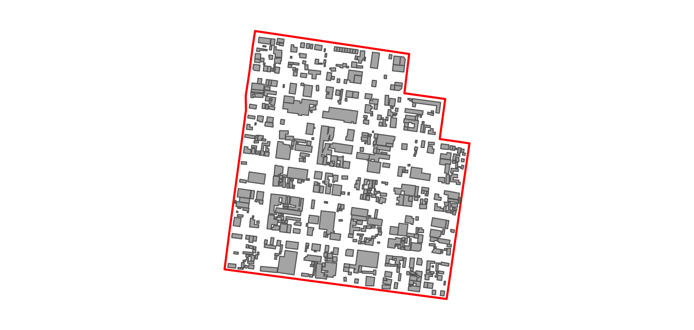
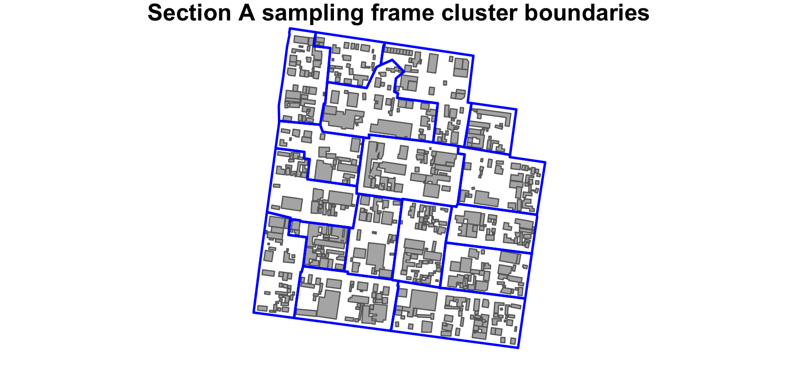
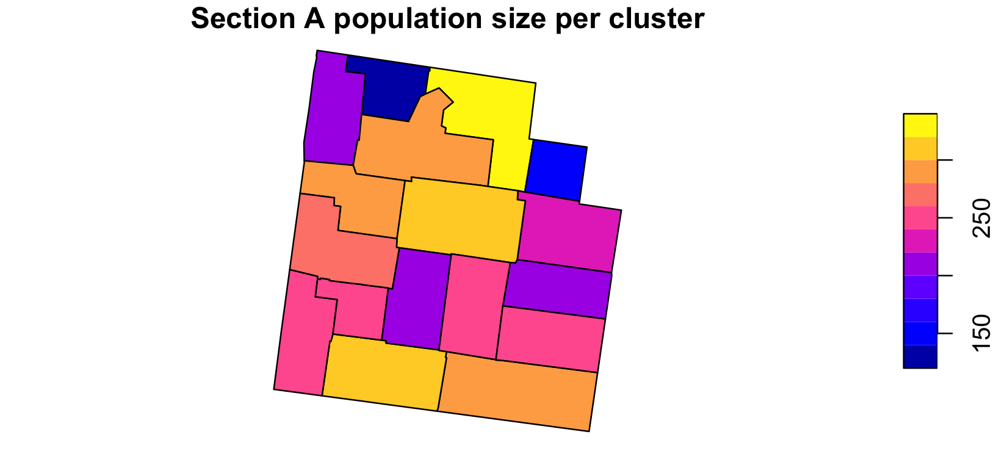
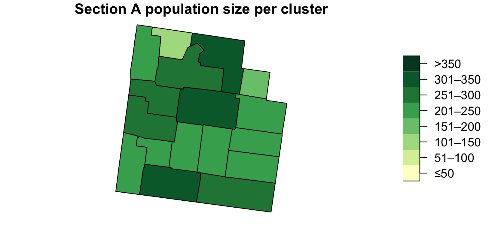
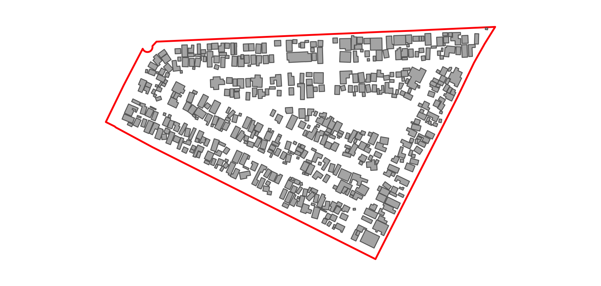
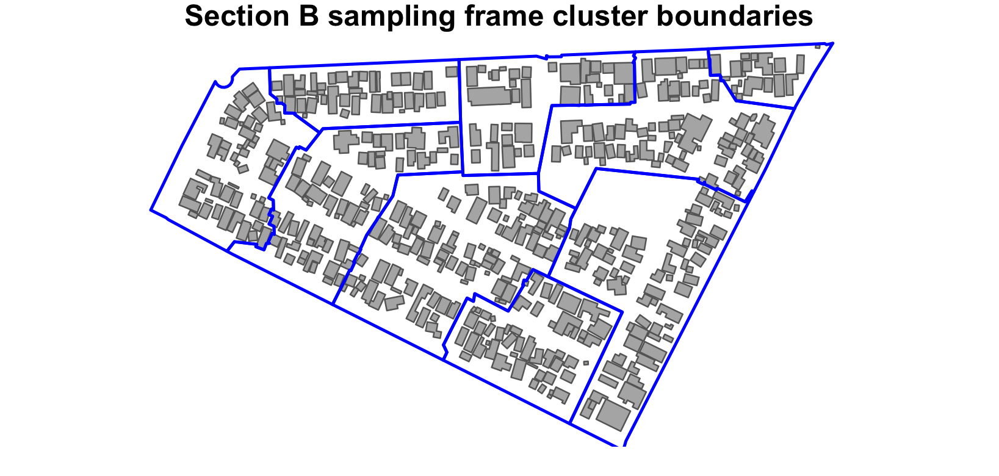
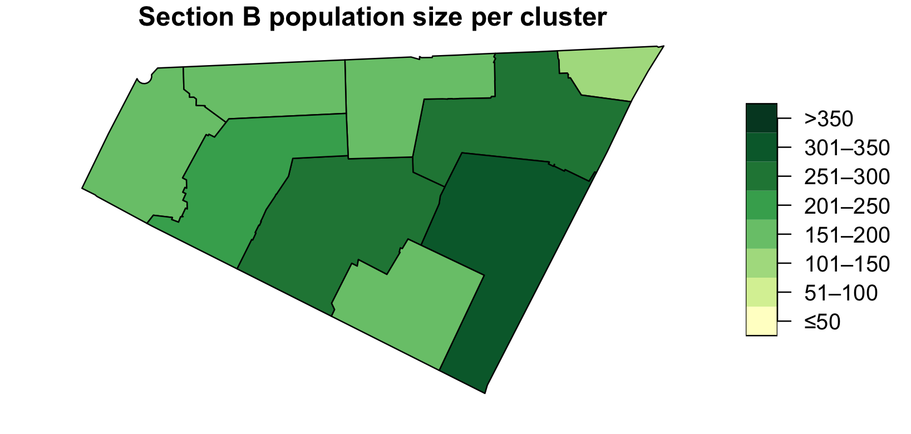
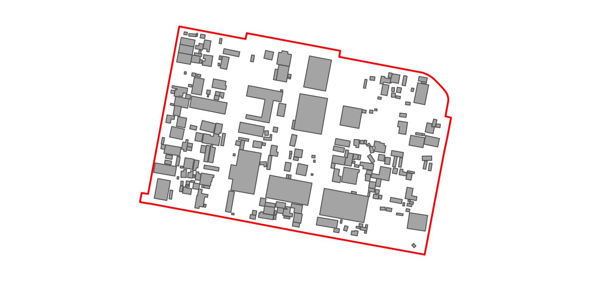
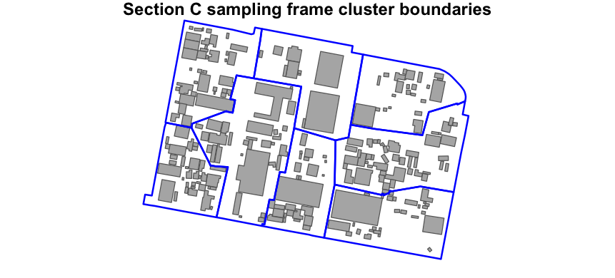
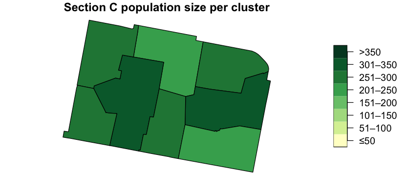

<style>
#title-block-header .description {
  display: none;
}
</style>

{fig-align="center" width="90%"}

```{r}
#| label: setup-options
#| include: false

knitr::opts_chunk$set(
  collapse = TRUE,
  comment = "#>"
)
```

# Introduction

This tutorial demonstrates how `clusterComposer` can be applied using three example areas in Guatemala City.

The example areas represent different urban layouts:

- **Section A:** a regular road network layout with buildings arranged in clearly defined blocks;
- **Section B:** buildings arranged in a regular pattern within a more irregular road network; and
- **Section C:** an irregular layout with variation in building size and arrangement.

For each example we use two GeoPackage files:

- a section boundary, saved in the format `sectionA.gpkg`; and
- a building-level population dataset, saved in the format `bfsA.gpkg`.

The example files are stored in the `clusterComposer` R package's `inst/extdata` directory. You'll be able to access these once you have the package is installed - instructions below.

The pre-prepared section boundaries were created using administrative boundaries and roads from Overture Maps (Overture Maps Foundation, 2026).

Ideally, an up-to-date population count would be available for each building so that clusters can be constructed to accurately contain the correct population size. However, where such detailed and up-to-date information is unavailable, clusters must be constructed based on estimated building-level population. For this example, in the absence of building-level population data, estimates were created by disaggregating WorldPop gridded population estimates (Bondarenko et al., 2025) across Overture building footprints (Overture Maps Foundation, 2026). Grid cell population estimates were distributed across the buildings according to their footprint area. Larger buildings were therefore assigned a greater share of a grid cell's population compared with smaller buildings in the same grid cell. This is just one example of how population can be assigned to buildings. Alternative approaches include distributing area-level population estimates evenly across all buildings within each area, or assigning a standard population count to every building across the entire study region.

# Install clusterComposer

We use the `pak` package to install `clusterCompser` and use the code below to ensure the package vignettes (further guides) are available.

If you already have `clusterComposer` installed, skip this section of code. 

```{r}
# if the pak package is not installed, install this first:
install.packages("pak")

# use the following two lines to install clusterComposer with vignettes available
Sys.setenv(PKG_BUILD_VIGNETTES = "true")
pak::pak("cadooley/clusterComposer",dependencies = TRUE)

```


# Create sampling frame clusters for three example areas

## Load packages

```{r}
#| label: setup

library(clusterComposer)
library(sf) # Load sf for reading and plotting spatial data
```

## Locate the example data files

```{r}
#| label: input-directory

extdata_path <- system.file("extdata", package = "clusterComposer")
```

## Locate the directory for output files

```{r}
#| label: output-directory
#| eval: false

# Set the directory in which you would like output files to be saved.
output_dir <- ""
```

```{r}
#| label: create-output-directory-if-needed

# Create the output folder within this directory if it does not already exist.
output_path <- file.path(output_dir, "output")
dir.create(output_path, recursive = TRUE, showWarnings = FALSE)
```

## Section A: regular road network layout with buildings arranged in clearly defined blocks

Read in the section boundary and buildings data, then plot them.

```{r}
#| label: section-a-inputs

AOI_A <- st_read(file.path(extdata_path, "sectionA.gpkg"))
bf_A <- st_read(file.path(extdata_path, "bfsA.gpkg"))

plot(st_geometry(AOI_A), border = "red", lwd = 2)
plot(st_geometry(bf_A), add = TRUE, col = "grey70", border = "grey40")
```

```{r}
#| label: section-a-layout-figure
#| eval: true
#| echo: false
#| out-width: 80%
#| fig-align: center


```

Section A has a regular grid-like arrangement of blocks of buildings.

Next, run `clusterComposer` for Section A.

```{r}
#| label: section-a-run

clusterComposer(
  aoi = AOI_A,
  bf_file_path = file.path(extdata_path, "bfsA.gpkg"),
  run_id = "guatemala_sectionA",
  output_file_path = output_path,
  n_cores = 1
)
```

In these examples, we run `clusterComposer` separately on each section (spatial area) and examine the results. When multiple sections are processed in a single run, `clusterComposer` can use parallel processing, with different sections processed simultaneously by different computing cores. Therefore, we generally recommend using the total number of available cores minus one, although fewer cores can be used. Here, only one section is processed at a time, so we use one core (`n_cores = 1`).

Now we can read in and plot the sampling frame boundaries produced for Section A. Note that `clusterComposer` saves files using the `run_id` followed by `_clusters.gpkg`. In this example, the file saved is `guatemala_sectionA_clusters.gpkg`.

```{r}
#| label: plot-section-a-results

# Plot the building footprints.
plot(
  st_geometry(bf_A),
  col = "grey70",
  border = "grey40",
  main = "Section A sampling frame boundaries"
)

# Read in the sampling frame units and add them to the plot.
sectionA_boundaries <- st_read(
  file.path(output_path, "guatemala_sectionA_clusters.gpkg")
)
plot(
  st_geometry(sectionA_boundaries),
  add = TRUE,
  col = NA,
  border = "blue",
  lwd = 2
)
```

```{r}
#| label: section-a-clusters-figure
#| eval: true
#| echo: false
#| out-width: 80%
#| fig-align: center


```

Now, plot the population sizes of the clusters.

```{r}
#| label: plot-pop-per-cluster

# clusterComposer calculates the population size for the final cluster
# boundaries and saves these values in a column called "pop".
plot(
  sectionA_boundaries[, "pop"],
  main = "Section A population size per cluster"
)
```

```{r}
#| label: section-a-pop-per-cluster-figure
#| eval: true
#| echo: false
#| out-width: 80%
#| fig-align: center


```

For comparisons across output sampling frames, it is easier to use standardised population bands and colour coding. Let's re-plot the population per cluster for Section A.

```{r}
#| label: plot-pop-per-cluster-scale

sectionA_boundaries$pop_band <- cut(
  sectionA_boundaries[["pop"]],
  breaks = c(-Inf, 50, 100, 150, 200, 250, 300, 350, Inf),
  labels = c(
    "≤50", "51–100", "101–150", "151–200",
    "201–250", "251–300", "301–350", ">350"
  ),
  include.lowest = TRUE
)

plot(
  sectionA_boundaries["pop_band"],
  pal = c(
    "#ffffcc", "#d9f0a3", "#addd8e", "#78c679",
    "#41ab5d", "#238443", "#006837", "#004529"
  ),
  main = "Section A population size per cluster"
)
```

```{r}
#| label: section-a-pop-per-cluster-scale-figure
#| eval: true
#| echo: false
#| out-width: 80%
#| fig-align: center


```

`clusterComposer` has a default target population per cluster of 250 people. In our Section A example, `clusterComposer` has successfully generated clusters with populations that are mostly close to this target. `clusterComposer` also has default settings for the maximum and minimum population size per cluster, which govern the range in population sizes across clusters. We will show some results for different population parameters later. First, let's look at two other example urban layouts.

## Section B: buildings arranged in a regular pattern within a more irregular road network

Read in the data, plot the section, then run `clusterComposer` for Section B.

```{r}
#| label: section-b

# Read in the data.
AOI_B <- st_read(file.path(extdata_path, "sectionB.gpkg"))
bf_B <- st_read(file.path(extdata_path, "bfsB.gpkg"))

# Plot the inputs.
plot(st_geometry(AOI_B), border = "red", lwd = 2)
plot(st_geometry(bf_B), add = TRUE, col = "grey70", border = "grey40")

clusterComposer(
  aoi = AOI_B,
  bf_file_path = file.path(extdata_path, "bfsB.gpkg"),
  run_id = "guatemala_sectionB",
  output_file_path = output_path,
  n_cores = 1
)
```

```{r}
#| label: section-b-layout-figure
#| eval: true
#| echo: false
#| out-width: 80%
#| fig-align: center


```

Plot the results.

```{r}
#| label: section-b-clusters

# Plot the building footprints.
plot(
  st_geometry(bf_B),
  col = "grey70",
  border = "grey40",
  main = "Section B sampling frame boundaries"
)

# Read in the sampling frame units and add them to the plot.
sectionB_boundaries <- st_read(
  file.path(output_path, "guatemala_sectionB_clusters.gpkg")
)
plot(
  st_geometry(sectionB_boundaries),
  add = TRUE,
  col = NA,
  border = "blue",
  lwd = 2
)
```

```{r}
#| label: section-b-clusters-figure
#| eval: true
#| echo: false
#| out-width: 80%
#| fig-align: center


```

```{r}
#| label: section-b-cluster-pop

# Plot population per cluster.
sectionB_boundaries$pop_band <- cut(
  sectionB_boundaries[["pop"]],
  breaks = c(-Inf, 50, 100, 150, 200, 250, 300, 350, Inf),
  labels = c(
    "≤50", "51–100", "101–150", "151–200",
    "201–250", "251–300", "301–350", ">350"
  ),
  include.lowest = TRUE
)

plot(
  sectionB_boundaries["pop_band"],
  pal = c(
    "#ffffcc", "#d9f0a3", "#addd8e", "#78c679",
    "#41ab5d", "#238443", "#006837", "#004529"
  ),
  main = "Section B population size per cluster"
)
```

```{r}
#| label: section-b-clusters-pop-figure
#| eval: true
#| echo: false
#| out-width: 80%
#| fig-align: center


```

## Section C: an irregular layout with variation in building size and arrangement

Read in the data, plot the section, then run `clusterComposer` for Section C.

```{r}
#| label: section-c

# Read in the data.
AOI_C <- st_read(file.path(extdata_path, "sectionC.gpkg"))
bf_C <- st_read(file.path(extdata_path, "bfsC.gpkg"))

# Plot the inputs.
plot(st_geometry(AOI_C), border = "red", lwd = 2)
plot(st_geometry(bf_C), add = TRUE, col = "grey70", border = "grey40")

clusterComposer(
  aoi = AOI_C,
  bf_file_path = file.path(extdata_path, "bfsC.gpkg"),
  run_id = "guatemala_sectionC",
  output_file_path = output_path,
  n_cores = 1
)
```

```{r}
#| label: section-c-layout-figure
#| eval: true
#| echo: false
#| out-width: 80%
#| fig-align: center


```

Plot the results.

```{r}
#| label: section-c-clusters

# Plot the building footprints.
plot(
  st_geometry(bf_C),
  col = "grey70",
  border = "grey40",
  main = "Section C sampling frame boundaries"
)

# Read in the sampling frame units and add them to the plot.
sectionC_boundaries <- st_read(
  file.path(output_path, "guatemala_sectionC_clusters.gpkg")
)
plot(
  st_geometry(sectionC_boundaries),
  add = TRUE,
  col = NA,
  border = "blue",
  lwd = 2
)
```

```{r}
#| label: section-c-clusters-figure
#| eval: true
#| echo: false
#| out-width: 80%
#| fig-align: center


```

```{r}
#| label: section-c-cluster-pop

# Plot population per cluster.
sectionC_boundaries$pop_band <- cut(
  sectionC_boundaries[["pop"]],
  breaks = c(-Inf, 50, 100, 150, 200, 250, 300, 350, Inf),
  labels = c(
    "≤50", "51–100", "101–150", "151–200",
    "201–250", "251–300", "301–350", ">350"
  ),
  include.lowest = TRUE
)

plot(
  sectionC_boundaries["pop_band"],
  pal = c(
    "#ffffcc", "#d9f0a3", "#addd8e", "#78c679",
    "#41ab5d", "#238443", "#006837", "#004529"
  ),
  main = "Section C population size per cluster"
)
```

```{r}
#| label: section-c-clusters-pop-figure
#| eval: true
#| echo: false
#| out-width: 80%
#| fig-align: center


```

# Create sampling frame clusters with different population parameters

We'll take Section A again and create sampling frames using the following population-per-cluster parameters:

- **Default settings:** target population = 250 people, maximum population = 350 people, minimum population = 150 people;
- **Smaller range in population per cluster:** target population = 250 people, maximum population = 300 people, minimum population = 200 people;
- **Smaller target population per cluster:** target population = 150 people, maximum population = 200 people, minimum population = 100 people; and
- **Larger target population per cluster:** target population = 500 people, maximum population = 600 people, minimum population = 400 people.

We already created the frame with the default settings above. Let's generate frames using the other sets of parameters and then plot the results.

```{r}
#| label: create-sampling-frames-var-pop-paras

# Read in the section boundary.
AOI_A <- st_read(file.path(extdata_path, "sectionA.gpkg"))

# Run clusterComposer for a smaller range of population sizes per cluster.
clusterComposer(
  aoi = AOI_A,
  bf_file_path = file.path(extdata_path, "bfsA.gpkg"),
  run_id = "guatemala_sectionA_smallPopRange",
  output_file_path = output_path,
  pop_per_EZ = 250,
  max_pop_per_EZ = 300,
  min_pop_per_EZ = 200,
  n_cores = 1
)

# Run clusterComposer for a smaller target population size per cluster.
clusterComposer(
  aoi = AOI_A,
  bf_file_path = file.path(extdata_path, "bfsA.gpkg"),
  run_id = "guatemala_sectionA_smallPopTarget",
  output_file_path = output_path,
  pop_per_EZ = 150,
  max_pop_per_EZ = 200,
  min_pop_per_EZ = 100,
  n_cores = 1
)

# Run clusterComposer for a larger target population size per cluster.
clusterComposer(
  aoi = AOI_A,
  bf_file_path = file.path(extdata_path, "bfsA.gpkg"),
  run_id = "guatemala_sectionA_largePopTarget",
  output_file_path = output_path,
  pop_per_EZ = 500,
  max_pop_per_EZ = 600,
  min_pop_per_EZ = 400,
  n_cores = 1
)

# Read in the four Section A frames.
section_boundaries1 <- st_read(
  file.path(output_path, "guatemala_sectionA_clusters.gpkg")
)
section_boundaries2 <- st_read(
  file.path(output_path, "guatemala_sectionA_smallPopRange_clusters.gpkg")
)
section_boundaries3 <- st_read(
  file.path(output_path, "guatemala_sectionA_smallPopTarget_clusters.gpkg")
)
section_boundaries4 <- st_read(
  file.path(output_path, "guatemala_sectionA_largePopTarget_clusters.gpkg")
)

# Classify clusters into fixed population bands.
pop_breaks <- c(-Inf, 100, 200, 300, 400, 500, 600, Inf)
pop_labels <- c(
  "≤100", "101–200", "201–300", "301–400",
  "401–500", "501–600", ">600"
)

section_boundaries1$pop_band <- cut(
  section_boundaries1[["pop"]], pop_breaks, labels = pop_labels
)
section_boundaries2$pop_band <- cut(
  section_boundaries2[["pop"]], pop_breaks, labels = pop_labels
)
section_boundaries3$pop_band <- cut(
  section_boundaries3[["pop"]], pop_breaks, labels = pop_labels
)
section_boundaries4$pop_band <- cut(
  section_boundaries4[["pop"]], pop_breaks, labels = pop_labels
)

# Plot the results.
pop_palette <- rev(hcl.colors(7, "Purples"))

plot(
  section_boundaries1["pop_band"],
  pal = pop_palette,
  main = paste0(
    "Default settings\n",
    "Target population per cluster = 250 (maximum = 350, minimum = 150)"
  ),
  cex.main = 0.7
)
plot(
  section_boundaries2["pop_band"],
  pal = pop_palette,
  main = paste0(
    "Smaller range in population per cluster\n",
    "Target population per cluster = 250 (maximum = 300, minimum = 200)"
  ),
  cex.main = 0.7
)
plot(
  section_boundaries3["pop_band"],
  pal = pop_palette,
  main = paste0(
    "Smaller target population per cluster\n",
    "Target population per cluster = 150 (maximum = 200, minimum = 100)"
  ),
  cex.main = 0.7
)
plot(
  section_boundaries4["pop_band"],
  pal = pop_palette,
  main = paste0(
    "Larger target population per cluster\n",
    "Target population per cluster = 500 (maximum = 600, minimum = 400)"
  ),
  cex.main = 0.7
)
```

```{r}
#| label: section-a-pop-paras-figures
#| eval: true
#| echo: false
#| out-width: 80%
#| fig-align: center

knitr::include_graphics(c(
  "resources/Guatemala_sectionA_defaultpop.png",
  "resources/Guatemala_sectionA_smallpoprange.png",
  "resources/Guatemala_sectionA_smallpop.png",
  "resources/Guatemala_sectionA_largepop.png"
))
```

Using the default population settings, 17 clusters were formed. When the permitted population range was narrowed, 20 clusters were formed, several of which had populations below the minimum of 200. `clusterComposer` treats the maximum as a stricter constraint than the minimum, preferring two clusters below the minimum to one cluster above the maximum.

When the target population was reduced to 150 people, 31 clusters were formed. Most had populations within the specified range of 100–200 people, although a few fell below the minimum. No clusters exceeded the maximum of 200 people.

When the target population was increased to 500 people, just 10 clusters were formed. Five had populations within the specified range, while the other five fell below the minimum. No clusters exceeded the maximum.

# Summary

This tutorial provides a guide on how to run `clusterComposer` to create sampling frames for small example areas. It also demonstrates how `clusterComposer` performs across contrasting urban forms and for different population-per-cluster settings.

The accuracy of the sampling frames generated by `clusterComposer` depends on the quality of the building footprints and building-level population estimates provided. Users should therefore carefully assess and amend these input data before running `clusterComposer`.

# References

Overture Maps Foundation. Overture Maps Data. Overture Maps Foundation. Accessed November 2026. Data attribution: Overture Maps Foundation, [overturemaps.org](https://overturemaps.org). © OpenStreetMap contributors.

Bondarenko M., Priyatikanto R., Tejedor-Garavito N., Zhang W., McKeen T., Cunningham A., Woods T., Hilton J., Cihan D., Nosatiuk B., Brinkhoff T., Tatem A., Sorichetta A. 2025. *Constrained estimates of 2015–2030 total number of people per grid square at a resolution of 3 arc (approximately 100 m at the equator), R2025A version v1*. Global Demographic Data Project, funded by the Bill & Melinda Gates Foundation (INV-045237). WorldPop, School of Geography and Environmental Science, University of Southampton. DOI: [10.5258/SOTON/WP00839](https://doi.org/10.5258/SOTON/WP00839). Data downloaded from [WorldPop](https://hub.worldpop.org/geodata/summary?id=73681) on 8 November 2026.
