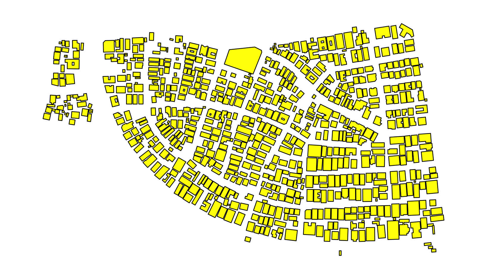
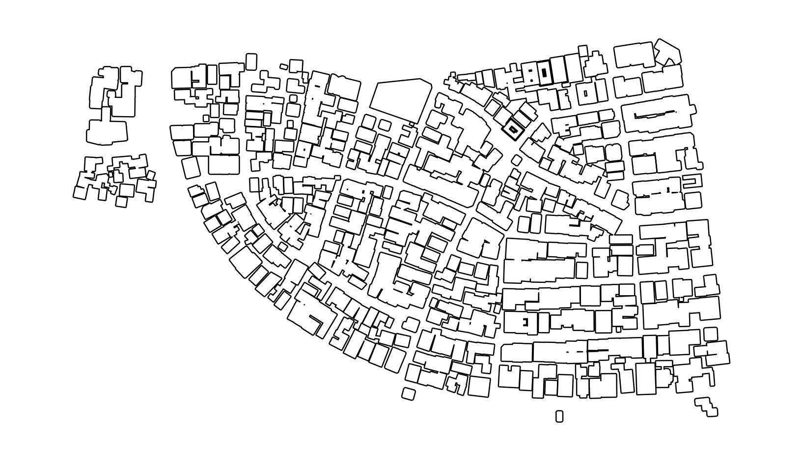
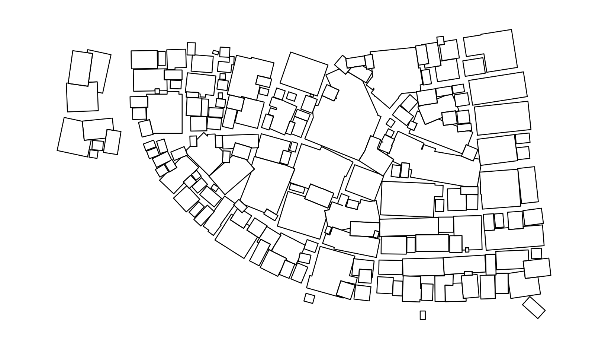
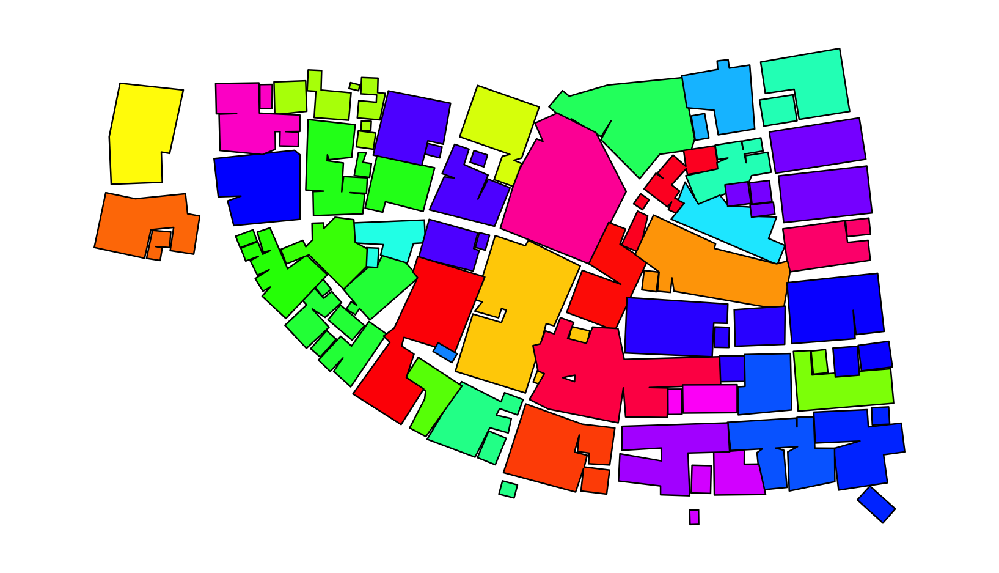
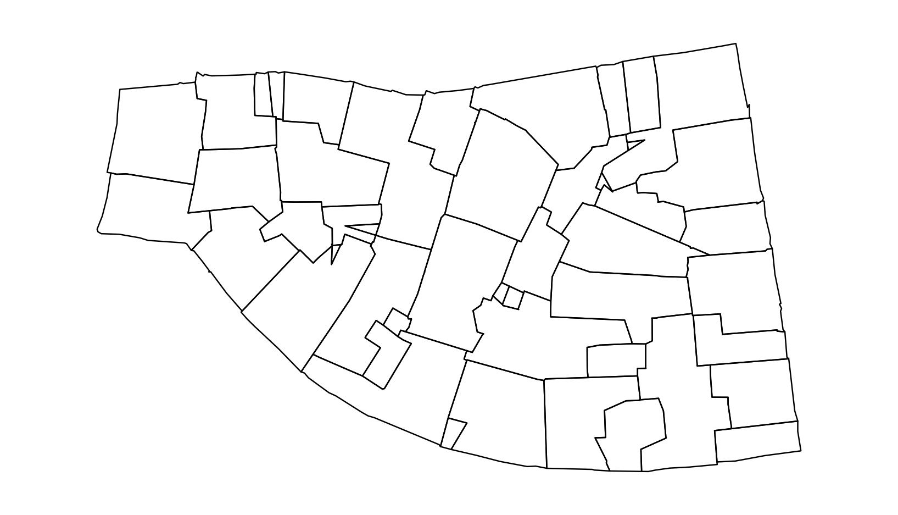
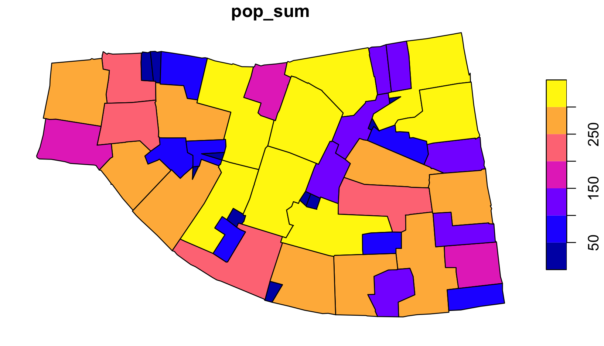
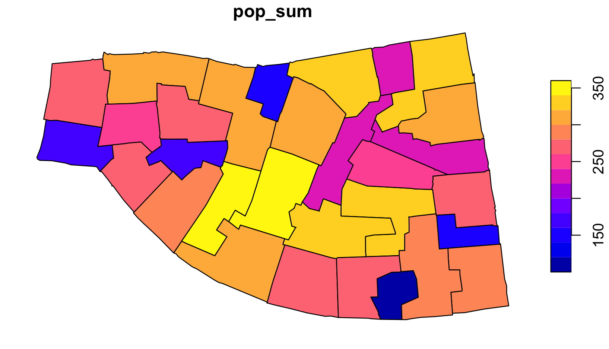
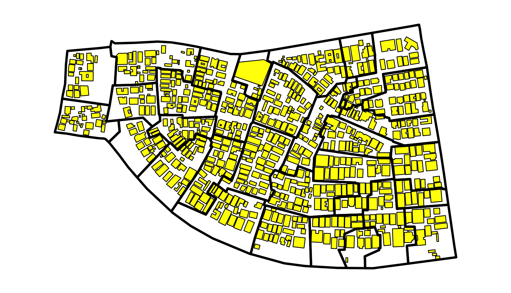

<style>
#title-block-header .description {
  display: none;
}
</style>

{fig-align="center" width="90%"}

The clusterComposer tool ([Dooley et al. 2026](https://github.com/cadooley/clusterComposer)) creates spatial clusters from building footprints and estimated population counts per building. It is designed to produce clusters that meet specified population thresholds while remaining spatially coherent and practical for field enumeration.

The process is summarised below using an example set of building footprints obtained from the Overture Maps Foundation buildings dataset (Overture Maps Foundation, accessed November 2026).


```{r}
#| label: fig-input-buildings
#| echo: false
#| out-width: "100%"
#| fig-cap: "Example building footprints used as input to the cluster construction process. Data attribution: Overture Maps Foundation, overturemaps.org. © OpenStreetMap contributors."


```

## Step 1: Group nearby buildings

Building footprints are buffered a small amount, and overlapping buffers are merged to create collections of buildings that are in close proximity.

The buffer distance is selected adaptively. It is set so that the estimated population of a building collection does not exceed the specified maximum population per cluster, or enumeration zone. Consequently, different building collections may be created using different buffer distances, depending on the local density and distribution of buildings and population.

The goal of this first step is to group together buildings in very close proximity without exceeding the set cluster population threshold.

```{r}
#| label: fig-step-1
#| echo: false
#| out-width: "100%"
#| fig-cap: "Step 1: Buildings are grouped into collections based on proximity and population constraints."


```

## Step 2: Define coherent cluster areas

Minimum-area rectangles are created around the building collections. Rectangles with substantial overlap are then merged.

This step helps to define sensible cluster areas and reduces the likelihood that separate building collections become spatially intertwined. The resulting areas provide a clearer spatial structure for the subsequent clustering process.

```{r}
#| label: fig-step-2
#| echo: false
#| out-width: "100%"
#| fig-cap: "Step 2: Minimum-area rectangles are created around building collections and merged where they overlap substantially."


```

## Step 3: Combine building collections into clusters

Hierarchical clustering is applied to spatially combine blocks of building collections. This step produces a hierarchical tree of potential clustering options. The tree is examined and the combinations of building collections that meet the desired population range are selected as clusters. 

```{r}
#| label: fig-step-3
#| echo: false
#| out-width: "100%"
#| fig-cap: "Step 3: Hierarchical clustering combines building collections to achieve the target population per cluster."


```

## Step 4: Allocate gaps between clusters

Any small unallocated spaces between clusters are assigned to a neighbouring cluster. Each space is allocated to the neighbouring cluster with which it shares the longest boundary.

This produces a complete set of adjoining cluster polygons without small gaps between them.

```{r}
#| label: fig-step-4
#| echo: false
#| out-width: "100%"
#| fig-cap: "Step 4: Small spaces between clusters are assigned according to the longest shared boundary."


```

The next step considers the population sizes of clusters, so let's see what these look like at this stage of the process.

```{r}
#| label: fig-step-4b
#| echo: false
#| out-width: "100%"
#| fig-cap: "Post Step 4 population per cluster."


```


## Step 5: Merge clusters below the minimum population threshold

Clusters whose estimated populations fall below the specified minimum are combined with suitable neighbouring clusters. A merge is permitted only when the population of the resulting cluster does not exceed the maximum population threshold.

Where several valid neighbouring clusters are available, the function selects the combination that produces the most spatially compact result. This balances the population requirements with the need to create practical cluster shapes.

```{r}
#| label: fig-step-5
#| echo: false
#| out-width: "100%"
#| fig-cap: "Step 5: Clusters below the minimum population are merged with suitable neighbours."


```

## Step 6: Refine cluster boundaries

Finally, cluster boundaries are cleaned and refined. The boundaries are adjusted so that they pass around buildings rather than through them, and unnecessary irregularities are removed.

This step produces boundaries that are smoother, more interpretable and more suitable for use in mapping and field enumeration.

```{r}
#| label: fig-step-6
#| echo: false
#| out-width: "100%"
#| fig-cap: "Step 6: Cluster boundaries are refined to follow sensible routes around buildings. Data attribution: Overture Maps Foundation, overturemaps.org. © OpenStreetMap contributors."


```

## References

Dooley, C. A., Clary, C. B., Rhoda, D. A., & Thomson, D. R. (2026). clusterComposer: Generate Bespoke Spatial Sampling Frames from Buildings. R package version 0.1.1. DOI: [https://doi.org/10.5281/zenodo.24353237](https://doi.org/10.5281/zenodo.24353237). Repository: [https://github.com/cadooley/clusterComposer](https://github.com/cadooley/clusterComposer).


Overture Maps Foundation. *Overture Maps data*. [https://overturemaps.org/](https://overturemaps.org/). Accessed November 2026.