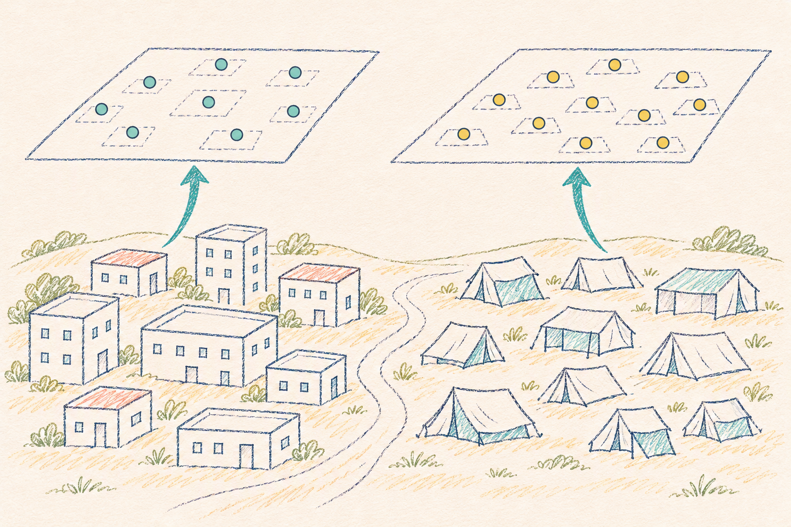

<style>
#title-block-header .description {
  display: none;
}
</style>

{fig-align="center" width="90%"}

## Introduction

This tutorial demonstrates how to generate a spatial sampling frame from building and tent location data using the `clusterComposer` R package. 

While `clusterComposer` was originally designed to derive sampling frames from building footprints, available footprint datasets do not adequately represent the current distribution of inhabited dwellings in Gaza. This tutorial therefore demonstrates an alternative workflow that uses locations of tent and buildings that are known to contain housing units as a substitute for building footprints. We then show how to use this alternative dataset to create a sampling frame.

The example covered in this tutorial creates a spatial sampling frame for Deir al Balah using building locations, tent locations, neighbourhood boundaries, and a road network. The neighbourhood boundaries and roads data are used to create sections. The building and tent points data are converted into dwelling polygons and each polygon has an associated number of housing units based on building damage data. The `clusterComposer` function is applied to build clusters of dwellings within each section that meet a target size of 150 housing units. At the end of the tutorial, the results are evaluated.

## 1. Define file paths

Define the root data directory and the relative paths to the building, tent, administrative boundary and road datasets, together with the paths where intermediate data and final outputs will be saved.

```{r define-file-paths}
data_dir <- ""

blds_filepath <- "raw/"
tents_filepath <- "raw/"
admin_filepath <- "raw/"
roads_path <- "raw/"
cc_input_path <- "in/" 
cc_output_path <- "out/" 
```

## 2. Install and load the required packages

The code below install the `pak` R package. The `pak` function is then used to install `clusterComposer`. You only ever need to run code to install packages the first time you are using them or to update them so you do not need to run this code every time a new analysis or new session of R is started.

```{r install}
# install "pak" if not installed
install.packages("pak")
# use pak to install clusterComposer
pak::pak("cadooley/clusterComposer")
```

Load packages needed for data preparation, running
`clusterComposer`, and exploring the results.

```{r load-packages}
# libraries for data prep, generating sampling frame & exploration of results
library(sf)
library(terra)
library(data.table)
library(clusterComposer)
library(ggplot2)
```


## 3. Read the input datasets

Read the building locations (UNOSAT, 2025), tent locations (Zhang et al. 2026), administrative boundaries (UNOCHA 2025), and road network (HOTOSM 2025). The road dataset is then restricted to roads within the Gaza Strip. 

```{r read-input-data}
# read in data
bld_points <- st_read(paste0(
  data_dir,
  blds_filepath,
  "UNOSAT_GazaStrip_CDA_11October2025_HU.gdb"
))
tent_points <- st_read(paste0(
  data_dir,
  tents_filepath,
  "gaza_tent_points_20261016.gpkg"
))
admin <- st_read(paste0(
  data_dir,
  admin_filepath,
  "gaza_neighbourhood_boundaries.gpkg"
))
roads <- st_read(paste0(data_dir, roads_path,"roads.gpkg"))
roads <- roads[roads$adm1_name == "Gaza Strip", ]
```
Plot your administrative units to look at their size and layout. The image below is based on the boundaries used in this tutorial - your plot will differ when using another boundary dataset.

``` {r plot-admin}
# look at column names
names(admin)
# plot using an appropriate column name
plot(admin[,"ADM3_EN"])
```
```{r}
#| label: gaza-admin-boundaries-figure
#| eval: true
#| echo: false
#| out-width: 80%
#| fig-align: center

knitr::include_graphics("resources/gaza_adminBoundaries.png")
```

## 4. Transform the spatial datasets

Transform all spatial datasets to EPSG:32636 so that spatial operations and
distance-based calculations are performed in a projected coordinate reference
system with metre-based units.

```{r transform-spatial-data}
# buildings data includes a thirs coordinate for each point which gives height/elevation information
# this is simply 0 for most points, so let's remove it as it is not relevant to our analysis
bld_points <- st_zm(bld_points, drop = TRUE)
# espg 32636
bld_points <- st_transform(bld_points, 32636)
tent_points <- st_transform(tent_points, 32636)
admin <- st_transform(admin, 32636)
roads <- st_transform(roads, 32636)
```

## 5. Calculate housing units per building

The buildings data here contains a column `HU_tot` which gives the original number of housing units in a building. The dataset also contain an estimate of the number of housing units per building that are damaged in `HU_damaged_14`. Calculate the original number minus those damaged to obtain an estimate of remaining housing units per building.

``` {r}
# if original number of housing units is NA, assume this means 0
bld_points$HU_tot[is.na(bld_points$HU_tot)] <- 0
# if number of housing units damaged is NA, assume this means 0 units have been damaged
bld_points$HU_damaged_14[is.na(bld_points$HU_damaged_14)] <- 0
# calculate to remaining housing units associated with each building point
bld_points$hu_update <- bld_points$HU_tot - bld_points$HU_damaged_14
```

## 6. Convert building and tent point locations into spatial polygons

Buffer building points by 5 metres and tent points by 2 metres to create the polygon geometries required by `clusterComposer`. Combine these into a single spatial object.

```{r prepare-building-and-tent-input}
# buffer building points
bld_polys <- st_buffer(bld_points, 5)
# buffer tent points
tent_polys <- st_buffer(tent_points, 2)

# bring building and tent polygons into one object

# note we use the column name "pop_building" because this is what the clusterComposer function expects, but we'll put count of dwellings per building here
# specify one housing unit per tent
tent_polys$pop_building <- 1 
# rename the column in the building points 
names(bld_polys)[names(bld_polys)=="hu_update"] <- "pop_building"
# rename the buildings geometry column to match that for the tents object
names(bld_polys)[names(bld_polys) == attr(bld_polys, "sf_column")] <- "geom"
attr(bld_polys, "sf_column") <- "geom"

# put buildings and tents in the same object, include number of housing units
dwellings <- rbind(bld_polys[,"pop_building"],tent_polys[,"pop_building"])

```
Next, we save the complete dwellings object, covering the full area for which building and tent locations are available. As this object may contain a large number of points, the resulting file can be substantial and may take time to save. Consider subsetting the data to the required area before saving.

``` {r save-dwellings}
# save as gpkg
st_write(dwellings,paste0(data_dir,cc_input_path,"dwelling_buffered_points.gpkg"),delete_dsn=TRUE)
```

## 7. Select area for the sampling frame 

While `clusterComposer` is still under development, we recommend generating sampling frames for specific areas and examine outputs before creating frames for large regions. 

Select the Deir al Balah area at administrative unit level 3 (ADM3).

```{r select-area-of-interest}
# test for Deir al Balah
aoi_initial <- admin[admin$ADM3_EN == "Deir al Balah", ]
aoi_initial$section_id <- 1:nrow(aoi_initial)
```

## 8. Create suitable sections within the area of interest

We now want to focus on creating reasonable areal units that `clusterComposer` can efficiently process. 

First, we count the dwelling locations intersecting each section within the area of interest. Note, this is just counting the number of dwelling locations not the number of housing units as we are more interested in the amount of polygons inside our large units, rather than population as it is the spatial processing that is computationally intensive. 

```{r count-points-by-section}
# omit dwellings with zero housing units
dwellings <- dwellings[!dwellings$pop_building==0,]
# number of buildings and tents per section
aoi_initial$dwelling_count <- lengths(sf::st_intersects(aoi_initial, dwellings))
```

Plot the counts of dwellings across the units within the area of interest. 

``` {r plot-admin-dwellings}
# look at column names
names(aoi_initial)
# plot using an appropriate column name
plot(aoi_initial[,"dwelling_count"],
     pal = function(n) hcl.colors(n, palette="Terrain",rev="TRUE"),
     main="Counts of occupied dwellings per admin unit")
# we can look at the full list the counts of dwellings per section 
sort(aoi_initial$dwelling_count)
```
```{r}
#| label: gaza-dwellings-per-admin-figure
#| eval: true
#| echo: false
#| out-width: 80%
#| fig-align: center

knitr::include_graphics("resources/gaza_dwellings_per_adminUnit.png")
```

In this example, the range in counts of dwellings per section is 462 to 11,453.

Next, we want to identify and divide large sections. Start by selecting sections containing more than 2000 dwelling locations and cut these up into smaller sections using roads data.

To achieve this, the road geometries and area boundaries are combined, noded, and polygonised to create smaller subsections.

```{r divide-large-sections}
# we don't want to use all the roads for this step as this would create many very small sections so subset to major roads
roads_major <- roads[roads$highway %in% c("trunk_link","trunk","tertiary_link","tertiary","secondary_link","secondary","primary_link","primary","motorway_link","motorway"),] 
# split areas with more than 800 buildings/tents using roads, prior to running cluster composer
aoi_big <- aoi_initial[aoi_initial$dwelling_count > 2000, ]
roads_aoi <- st_intersection(roads_major, st_buffer(aoi_big, 50))
sub_sections <- c(st_geometry(roads_aoi), st_geometry(st_boundary(aoi_big)))
lines <- st_union(sub_sections)
lines <- st_node(lines)
poly_strata <- st_polygonize(lines)
polygons <- st_collection_extract(poly_strata, "POLYGON")
polygons <- st_cast(polygons, "POLYGON")
polygons_sf <- st_as_sf(polygons)
polygons_sf <- polygons_sf[!st_is_empty(polygons_sf), ]
polygons_sf <- st_make_valid(polygons_sf)
polygons_sf$area <- st_area(polygons_sf)
```
The above code creates lots of smaller polygons from the large sections. As the road network was used to split these areas, we now have some undesirable polygons, e.g. thin strips of land between a road edge and the neighbourhod boundary. So, next, we merge these into neighbouring polygons that share the longest boundary.

The procedure is repeated until no polygons below a set threshold remain or no further suitable merge can be made. In this example, we set the threshold to be 50,000 m^2^. 

```{r merge-small-polygons}
# set area threshold
thresh <- 50000

# merge small polys into neighbours
repeat {
  small_idx <- which(as.numeric(polygons_sf$area) < thresh)
  if (length(small_idx) == 0) {
    break
  }
  merged_any <- FALSE
  for (i in small_idx) {
    nbr_idx <- st_intersects(polygons_sf[i, ], polygons_sf)[[1]]
    nbr_idx <- setdiff(nbr_idx, i)

    if (length(nbr_idx) == 0) {
      next
    }

    shared_len <- sapply(nbr_idx, function(j) {
      shared <- st_intersection(
        st_boundary(st_make_valid(st_geometry(polygons_sf[i, ]))),
        st_boundary(st_make_valid(st_geometry(polygons_sf[j, ])))
      )
      sum(as.numeric(st_length(shared)))
    })

    if (max(shared_len) == 0) {
      next
    }

    target <- nbr_idx[which.max(shared_len)]

    st_geometry(polygons_sf[target, ]) <- st_union(
      st_make_valid(st_geometry(polygons_sf[target, ])),
      st_make_valid(st_geometry(polygons_sf[i, ]))
    )

    polygons_sf <- polygons_sf[-i, ]

    merged_any <- TRUE
    break
  }

  if (!merged_any) break
}

polygons_sf <- polygons_sf[!st_is_empty(polygons_sf), ]
```

The aim of this step is to reduce the number of annoying small polygons that are likely to contain very low populations by merging them with neighbouring units. For simplicity, polygons are selected for merging based on an area threshold. 

This step could be developed to play a more significant role in preparing the data whereby the above code could be adapted to allow merges based on dwelling (or population) counts. This could be an important addition if there are many sections with a low population because the sections we are preparing will be passed to clusterComposer for division into clusters/enumeration zones, and sections that are already small will remain unchanged. Merging them at this stage can therefore help avoid retaining unnecessarily small, low-population units in the final sampling frame.

To complete the preparation of suitable sections within our area of interest, recalculate dwelling counts for newly formed sections and add these to the object containing the sections we did not split up.

```{r recount-points-in-new-sections}
# count dwelling locations for new polygons
polygons_sf$dwelling_count <- lengths(sf::st_intersects(polygons_sf, dwellings))

# rename geometry col to match that of aoi
names(polygons_sf)[
  names(polygons_sf) == attr(polygons_sf, "sf_column")
] <- "geom"
attr(polygons_sf, "sf_column") <- "geom"

# add to previous sections
aoi <- rbind(
  aoi_initial[aoi_initial$dwelling_count <= 2000,"dwelling_count"],
  polygons_sf[, "dwelling_count"]
)
aoi$area <- st_area(aoi)
aoi$section_id <- 1:nrow(aoi)
```

Plot the updated sections and their count of dwellings to compare with our plot above (noting the different colour scales).

``` {r plot-section-dwellings}
# plot using an appropriate column name
plot(aoi[,"dwelling_count"],
     pal = function(n) hcl.colors(n, palette="Terrain",rev="TRUE"),
     main="Counts of occupied dwellings per section")
# we can look at the full list the counts of dwellings per section 
sort(aoi$dwelling_count)
```
```{r}
#| label: gaza-dwellings-per-section-figure
#| eval: true
#| echo: false
#| out-width: 80%
#| fig-align: center

knitr::include_graphics("resources/gaza_dwellings_per_section.png")
```

## 9. Save the area of interest sections (optional)

Save the area of interest sections as a GeoPackage. The `st_write()` call is currently commented out. Remove the initial `#` when ready to write the file.

```{r save-area-of-interest}
# save the Areas of Interest
#st_write(aoi,paste0(data_dir,cc_input_path,"aoi_DeiralBalah.gpkg"),delete_dsn=TRUE)
```

## 10. Create sampling frame from `clusterComposer`

In this example, we work with number of housing units and so this is the unit of measure for our population parameters. We set the target population per cluster/enumeration zone (`pop_per_EZ` parameter) to 150 housing units and we set our maximum and minimum population per cluster/enumeration zone to 200 and 100 housing units, respectively.

```{r run-cluster-composer}
ncores <- parallel::detectCores() - 1

# run clusterComposer function
clusterComposer(
  aoi = aoi,
  bf_file_path = paste0(data_dir, cc_input_path, "dwelling_buffered_points.gpkg"),
  run_id = "gaza_dab_20261128_broadinitbuff",
  output_file_path = paste0(data_dir, cc_output_path),
  pop_per_EZ = 150,
  max_pop_per_EZ = 200,
  min_pop_per_EZ = 100,
  n_cores = ncores,
  initial_buffer_dist_max = 50,
  initial_buffer_dist_min = 50/8,
  delete_temp_files = FALSE
)
```

Now we can read in the sampling frame and take a look at the results.

``` {r results}
# read in the frame
sframe <- st_read(paste0(data_dir, cc_output_path,"gaza_dab_20261128_clusters.gpkg"))

# the sframe has a column "pop" which in this example is number of housing units
# plot number of housing units per cluster
plot(sframe[,"pop"], main = "Number of housing units per cluster")
# plot histogram of housing units per cluster
hist(sframe$pop,xlab = "Housing units per cluster",main = "Histogram of housing units per cluster",breaks=100)
# count how many clusters 
length(sframe$pop[sframe$pop<100])
length(sframe$pop[sframe$pop>=100 & sframe$pop<=200])
length(sframe$pop[sframe$pop>200])
```

