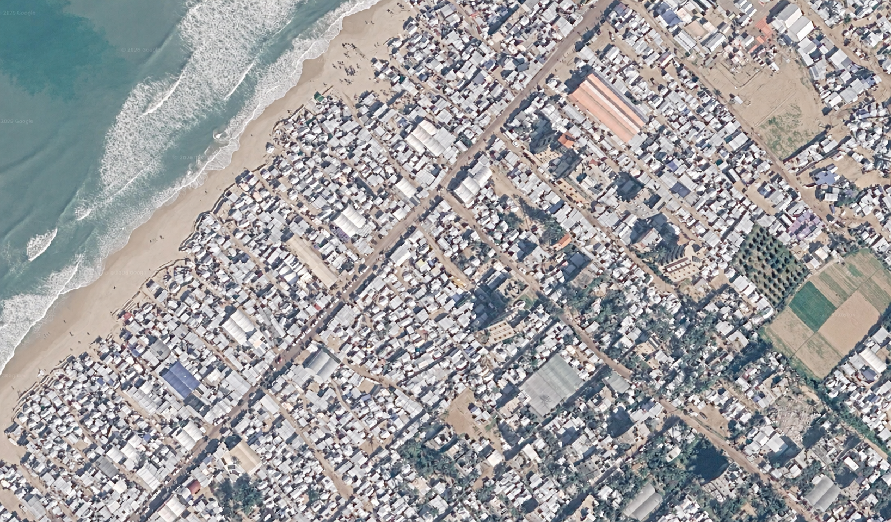

{fig-align="center" width="90%" .lightbox}

Automated tent mapping from satellite imagery allows us to quantify temporary dwellings to provide a current footprint of forcibly displaced populations as they move.

When people are forced from their homes by conflict, violence, or disaster, they often move quickly and settle where they can. This has been witnessed recently at a devastating scale as millions of Gazans have been forced into informal tent settlements as their homes have been systematically destroyed. Theese settlements can appear, expand, move, or disappear faster than conventional population data can be collected and updated. Yet knowing where people are living, and how those locations are changing, is essential for planning humanitarian assistance.

Automated tent mapping from satellite imagery gives us a powerful tool for monitoring and quantifying impermanent and mobile tent settlements. By mapping the locations of tents from regularly updated satellite imagery, we can identify areas where displaced communities are likely to be living right now, integrate digital traces as a signal of current occupancy, support the design of more representative surveys, and provide an input to population nowcasting to help guide humanitarian assistance to where it is needed. 

Our partners have been crucial for leading advancements in automated tent mapping from satellite imagery to support our humanitarian population nowcasting initiatives. This includes:  

- [Algorithmic Governance Foundation](https://algorithmicgovernance.org)  
- [Forensic Architecture](https://forensic-architecture.org/)  
- [Interdisciplinary Institute for Societal Computing](https://www.i2sc.net/)  
- [Center for Advanced Spatial Analysis](https://www.ucl.ac.uk/bartlett/casa)
- [Conflict Ecology](https://www.conflict-ecology.org)
- [Planet Labs](https://www.planet.com/)

In this book, we introduce our approach to automated tent mapping from satellite imagery. We will walk through the methods, the data they require, and the assumptions that need to be considered when using tent maps for humanitarian decision-making. Our aim is to make the workflow accessible, reproducible, and useful for others working to understand rapidly changing displacement situations.
