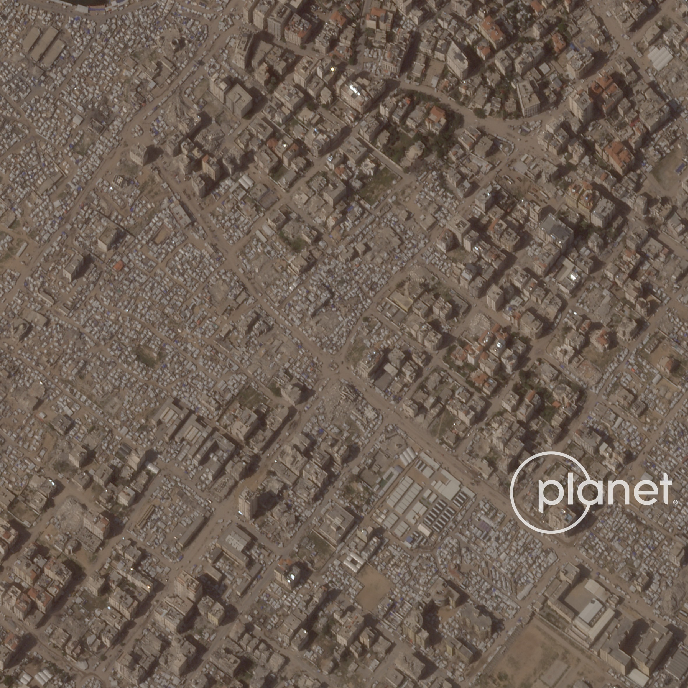
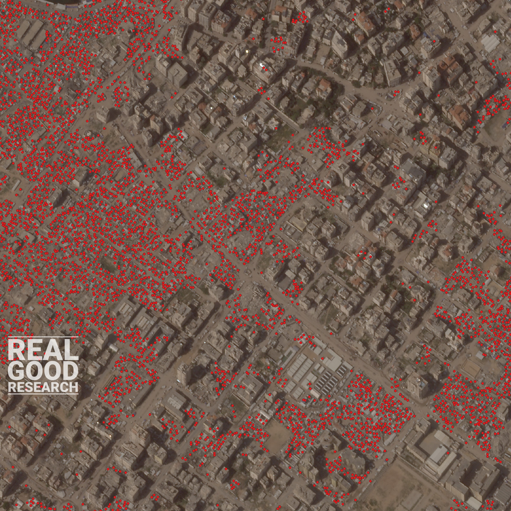

::: {.tentnetfa-slider-wrap}

<div class="tentnetfa-slider" aria-label="Interactive comparison of satellite imagery and TentNetFA tent detections">
  
  
  <div class="tentnetfa-slider-handle" aria-hidden="true"></div>
  <button class="tentnetfa-slider-fullscreen" type="button" title="Enter fullscreen" aria-label="Enter fullscreen">⛶</button>
</div>

Move the slider to compare satellite imagery with TentNetFA detections. Select the fullscreen button to enlarge the comparison.

:::

```{=html}
<style>
.tentnetfa-slider-wrap { max-width: 900px; margin: 1rem auto; }

.tentnetfa-slider {
  position: relative;
  width: 100%;
  aspect-ratio: 16 / 9;
  overflow: hidden;
  border-radius: 8px;
  cursor: ew-resize;
  touch-action: none;
  user-select: none;
}

.tentnetfa-slider img {
  position: absolute;
  inset: 0;
  width: 100%;
  height: 100%;
  object-fit: cover;
  display: block;
  pointer-events: none;
}

.tentnetfa-slider-overlay { clip-path: inset(0 50% 0 0); }

.tentnetfa-slider-handle {
  position: absolute;
  top: 0;
  bottom: 0;
  left: 50%;
  width: 2px;
  background: rgba(255, 255, 255, 0.95);
  box-shadow: 0 0 0 1px rgba(0, 0, 0, 0.35);
  pointer-events: none;
}

.tentnetfa-slider-handle::after {
  content: '';
  position: absolute;
  top: 50%;
  left: 50%;
  transform: translate(-50%, -50%);
  width: 28px;
  height: 28px;
  border-radius: 50%;
  background: rgba(255, 255, 255, 0.95);
  box-shadow: 0 0 0 1px rgba(0, 0, 0, 0.35);
}

.tentnetfa-slider-fullscreen {
  position: absolute;
  top: 12px;
  right: 12px;
  z-index: 10;
  padding: 6px 12px;
  background: rgba(0, 0, 0, 0.65);
  color: white;
  border: none;
  border-radius: 5px;
  cursor: pointer;
  font-size: 22px;
  line-height: 1;
}

.tentnetfa-slider:fullscreen {
  width: 100vw;
  height: 100vh;
  aspect-ratio: auto;
  border-radius: 0;
  background: #111;
}

.tentnetfa-slider:fullscreen img { object-fit: contain; }
</style>

<script>
(() => {
  const slider = document.querySelector('.tentnetfa-slider');
  if (!slider) return;

  const overlay = slider.querySelector('.tentnetfa-slider-overlay');
  const handle = slider.querySelector('.tentnetfa-slider-handle');
  const fullscreenButton = slider.querySelector('.tentnetfa-slider-fullscreen');
  let dragging = false;
  let position = 50;

  const update = (percentage) => {
    position = Math.min(Math.max(percentage, 0), 100);
    overlay.style.clipPath = `inset(0 ${100 - position}% 0 0)`;
    handle.style.left = `${position}%`;
  };

  const setPosition = (clientX) => {
    const rectangle = slider.getBoundingClientRect();
    const x = Math.min(Math.max(clientX - rectangle.left, 0), rectangle.width);
    update(rectangle.width === 0 ? 50 : (x / rectangle.width) * 100);
  };

  slider.addEventListener('pointerdown', (event) => {
    if (event.target === fullscreenButton) return;
    dragging = true;
    slider.setPointerCapture(event.pointerId);
    setPosition(event.clientX);
  });
  slider.addEventListener('pointermove', (event) => { if (dragging) setPosition(event.clientX); });

  const stopDragging = (event) => {
    dragging = false;
    if (slider.hasPointerCapture(event.pointerId)) slider.releasePointerCapture(event.pointerId);
  };
  slider.addEventListener('pointerup', stopDragging);
  slider.addEventListener('pointercancel', stopDragging);
  slider.addEventListener('pointerleave', () => { dragging = false; });

  fullscreenButton.addEventListener('click', (event) => {
    event.stopPropagation();
    if (document.fullscreenElement === slider) document.exitFullscreen();
    else slider.requestFullscreen();
  });

  document.addEventListener('fullscreenchange', () => {
    update(position);
    const label = document.fullscreenElement === slider ? 'Exit fullscreen' : 'Enter fullscreen';
    fullscreenButton.title = label;
    fullscreenButton.setAttribute('aria-label', label);
  });

  window.addEventListener('resize', () => update(position));
  update(position);
})();
</script>
```

<!-- Add TentNetFA overview content below this interactive figure. -->
