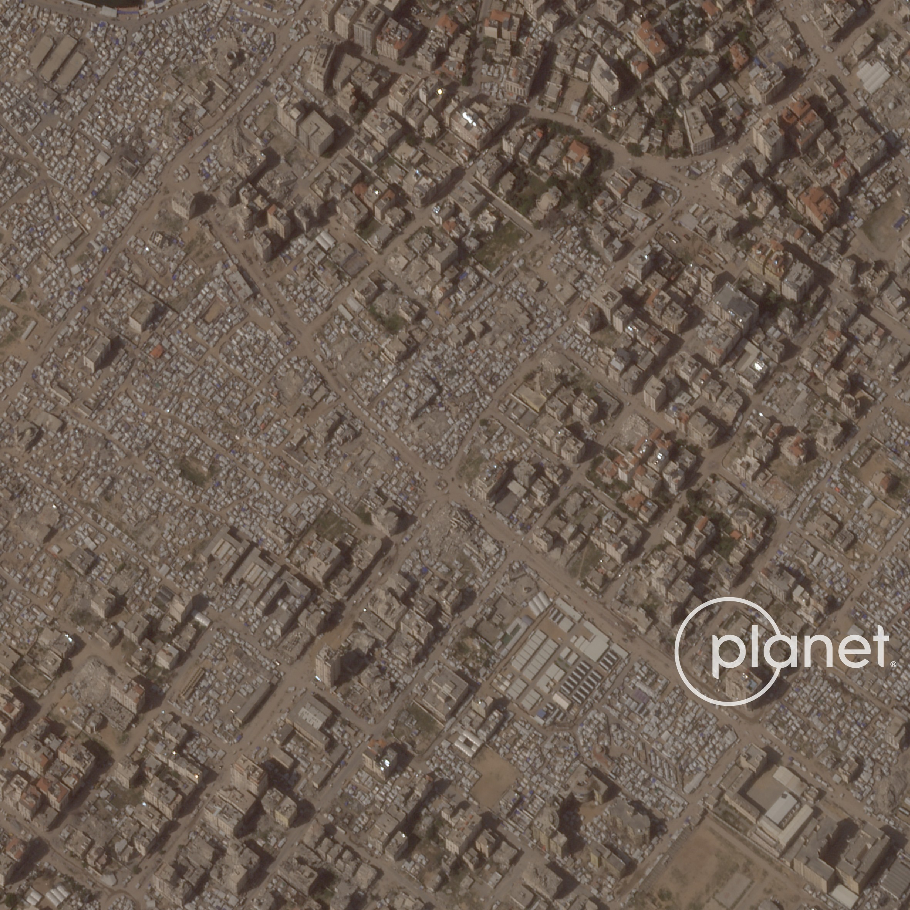
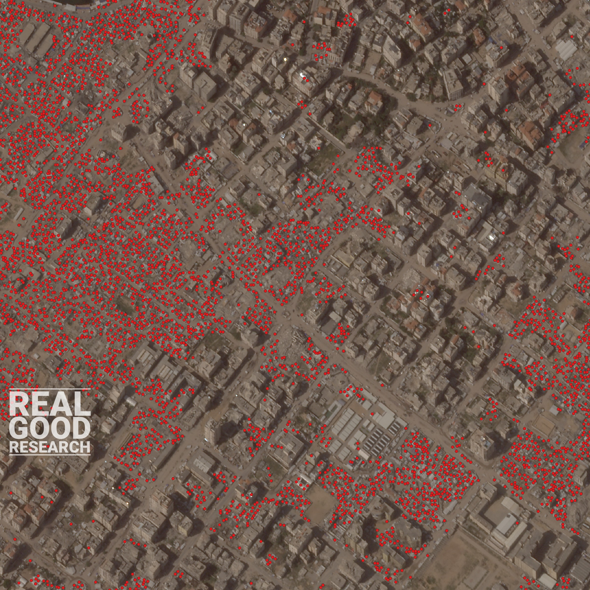
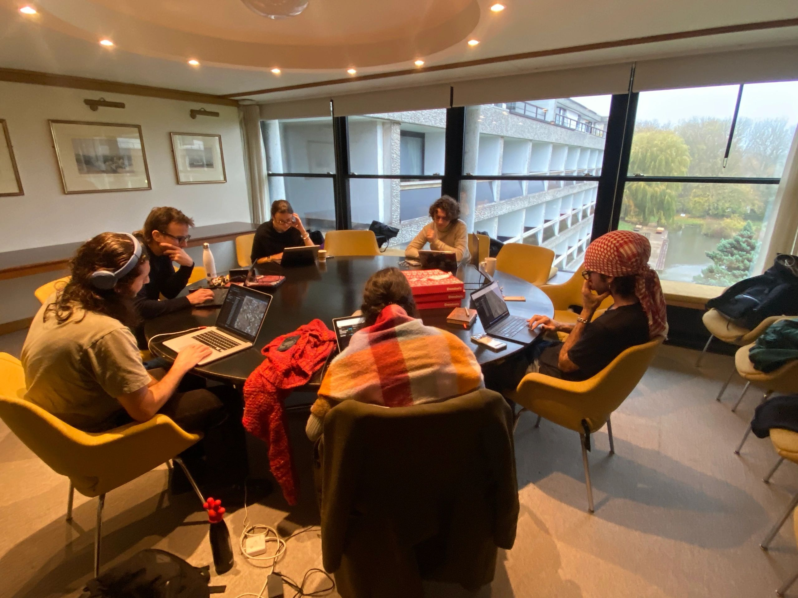
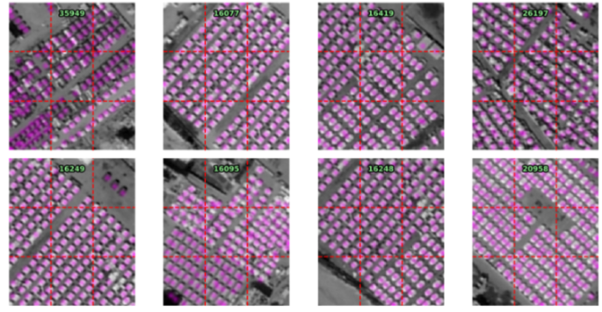

::: {.tentnetfa-slider-wrap}

<div class="tentnetfa-slider" aria-label="Interactive comparison of satellite imagery and TentNetFA tent detections">
  
  
  <div class="tentnetfa-slider-handle" aria-hidden="true"></div>
  <button class="tentnetfa-slider-fullscreen" type="button" title="Enter fullscreen" aria-label="Enter fullscreen">⛶</button>
</div>

Move the slider to compare satellite imagery with TentNetFA detections. Select the fullscreen button to enlarge the comparison.

:::

```{=html}
<style>
#title-block-header .description { display: none; }

.tentnetfa-slider-wrap { max-width: 900px; margin: 1rem auto; }

.tentnetfa-slider {
  position: relative;
  width: 100%;
  aspect-ratio: 16 / 9;
  overflow: hidden;
  border-radius: 8px;
  cursor: ew-resize;
  touch-action: none;
  user-select: none;
}

.tentnetfa-slider img {
  position: absolute;
  inset: 0;
  width: 100%;
  height: 100%;
  object-fit: cover;
  display: block;
  pointer-events: none;
}

.tentnetfa-slider-overlay { clip-path: inset(0 50% 0 0); }

.tentnetfa-slider-handle {
  position: absolute;
  top: 0;
  bottom: 0;
  left: 50%;
  width: 2px;
  background: rgba(255, 255, 255, 0.95);
  box-shadow: 0 0 0 1px rgba(0, 0, 0, 0.35);
  pointer-events: none;
}

.tentnetfa-slider-handle::after {
  content: '';
  position: absolute;
  top: 50%;
  left: 50%;
  transform: translate(-50%, -50%);
  width: 28px;
  height: 28px;
  border-radius: 50%;
  background: rgba(255, 255, 255, 0.95);
  box-shadow: 0 0 0 1px rgba(0, 0, 0, 0.35);
}

.tentnetfa-slider-fullscreen {
  position: absolute;
  top: 12px;
  right: 12px;
  z-index: 10;
  padding: 6px 12px;
  background: rgba(0, 0, 0, 0.65);
  color: white;
  border: none;
  border-radius: 5px;
  cursor: pointer;
  font-size: 22px;
  line-height: 1;
}

.tentnetfa-slider:fullscreen {
  width: 100vw;
  height: 100vh;
  aspect-ratio: auto;
  border-radius: 0;
  background: #111;
}

.tentnetfa-slider:fullscreen img { object-fit: contain; }
</style>

<script>
(() => {
  const slider = document.querySelector('.tentnetfa-slider');
  if (!slider) return;

  const overlay = slider.querySelector('.tentnetfa-slider-overlay');
  const handle = slider.querySelector('.tentnetfa-slider-handle');
  const fullscreenButton = slider.querySelector('.tentnetfa-slider-fullscreen');
  let dragging = false;
  let position = 50;

  const update = (percentage) => {
    position = Math.min(Math.max(percentage, 0), 100);
    overlay.style.clipPath = `inset(0 ${100 - position}% 0 0)`;
    handle.style.left = `${position}%`;
  };

  const setPosition = (clientX) => {
    const rectangle = slider.getBoundingClientRect();
    const x = Math.min(Math.max(clientX - rectangle.left, 0), rectangle.width);
    update(rectangle.width === 0 ? 50 : (x / rectangle.width) * 100);
  };

  slider.addEventListener('pointerdown', (event) => {
    if (event.target === fullscreenButton) return;
    dragging = true;
    slider.setPointerCapture(event.pointerId);
    setPosition(event.clientX);
  });
  slider.addEventListener('pointermove', (event) => { if (dragging) setPosition(event.clientX); });

  const stopDragging = (event) => {
    dragging = false;
    if (slider.hasPointerCapture(event.pointerId)) slider.releasePointerCapture(event.pointerId);
  };
  slider.addEventListener('pointerup', stopDragging);
  slider.addEventListener('pointercancel', stopDragging);
  slider.addEventListener('pointerleave', () => { dragging = false; });

  fullscreenButton.addEventListener('click', (event) => {
    event.stopPropagation();
    if (document.fullscreenElement === slider) document.exitFullscreen();
    else slider.requestFullscreen();
  });

  document.addEventListener('fullscreenchange', () => {
    update(position);
    const label = document.fullscreenElement === slider ? 'Exit fullscreen' : 'Enter fullscreen';
    fullscreenButton.title = label;
    fullscreenButton.setAttribute('aria-label', label);
  });

  window.addEventListener('resize', () => update(position));
  update(position);
})();
</script>
```

## What TentNetFA does

TentNetFA maps likely tent locations from high-resolution satellite imagery. It is designed for a difficult operational problem: settlements can grow, move, and change quickly, while a conventional field count may be unavailable, delayed, or unsafe to conduct. The output is a point map that can be aggregated into grids or administrative areas and used alongside other evidence in population nowcasting.

The method is not a way to identify people, households, or individual tents with certainty. It is a repeatable process for turning a satellite scene into an estimate of where tents are likely to be concentrated. Those estimates need to be interpreted with the imagery date, local conditions, and independent information in mind.

TentNetFA was developed from a tent-mapping effort with [Forensic Architecture](https://forensic-architecture.org/) using Planet satellite imagery and annotated tent locations. Its outputs support the wider population-nowcasting collaboration with humanitarian partners, including the United Nations, Acted, and IMPACT. The active implementation is maintained in the [TentNetFA source repository](https://github.com/realgoodresearch/TentNetFA).

{#fig-tentnetfa-volunteers fig-align="center" width="85%"}

*Image credit: [Algorithmic Governance Foundation, “Tracking Conflict Displacement in Gaza with Machine Learning.”](https://algorithmicgovernance.org/f/tracking-conflict-displacement-in-gaza-with-machine-learning)*

## The method in one view

The current workflow has two connected pipelines:

1. Build training examples from dated imagery and tent annotations, then fit a convolutional neural network (CNN).
2. Apply the fitted model to new imagery, convert its continuous output into points, and merge duplicate detections from overlapping tiles.

The important idea is that the CNN does not directly answer a yes-or-no question for every pixel. It predicts a smooth *tent-density surface*. A separate, explicit post-processing step then turns peaks in that surface into tent points. Keeping these steps separate makes it possible to inspect and tune the rules that determine how many points are ultimately reported.

## Training data: imagery, annotations, and change

Training begins with Planet GeoTIFF scenes and geographically referenced tent annotations. The annotations were originally produced for the Forensic Architecture mapping effort. For each training scene, TentNetFA selects annotations for the relevant date and rasterises the point locations into the coordinate system of the image.

Large scenes are divided into small, overlapping tiles. In the current configuration, each tile has a 70-metre core and a 15-metre margin on every side. The margins give the model context around the core and reduce edge artefacts. They also mean that the same ground location can occur in more than one prediction tile; the final merge step is therefore essential.

{#fig-tentnetfa-training-tiles fig-align="center" width="85%"}

Each tile contains three related RGB images:

- the current satellite image;
- a pre-war reference image covering the same location; and
- the channel-wise difference between the current and reference images.

Together these form a nine-channel input. The reference and difference layers help the model distinguish features that were already present from changes that may be associated with temporary shelter. They are useful evidence, not a guarantee: damage, rubble, agriculture, shadows, image quality, and other changes can also produce strong differences.

Before a tile is passed to the model, its image bands are standardised so that one scene's overall brightness does not dominate another's. The exact standardisation mode is recorded in the resolved configuration for a run. This does not make images identical, but it gives the model a more stable numerical scale on which to learn.

### From points to a learning target

A tent annotation is a point, but a point is too sparse to be a useful target for a pixel-level model. TentNetFA therefore converts every annotated point into a small Gaussian-shaped bump and adds the bumps together. The result is a density map: locations close to an annotated tent receive high values, and nearby pixels receive lower values that fade with distance. This family of approaches—learning a continuous surface from point annotations—has a long history in object-counting research [@lempitsky2010learning].

This representation gives the CNN a smoother learning problem. Rather than having to reproduce a single exact pixel, it learns to place a peak near each annotated tent. It also preserves a useful interpretation: summing the density surface over an area approximates the number of annotated tents in that area.

The width of the Gaussian is a modelling decision. A very narrow target approaches a hard point label and becomes sensitive to small alignment errors. A very broad target makes nearby tents harder to separate. TentNetFA records this setting with the training configuration so that the target surface can be reproduced.

Training data contain many tiles without tents. The pipeline retains only a configured fraction of these empty tiles when it builds the balanced training manifest. This prevents the model from learning the unhelpful rule that every location is empty simply because empty pixels are common.

## The convolutional neural network

The model is a compact CNN that accepts the nine-channel tile and returns one channel: a predicted density surface with the same spatial layout as the input. It combines several convolutional layers with batch normalisation and rectified linear activation functions. Dilated and wider convolutional layers give the model a larger local field of view without reducing the output resolution.

During training, the model compares its predicted density surface with the Gaussian-smoothed annotation surface using pixel-wise mean squared error. The checkpoint with the lowest validation loss is saved for prediction. The implementation uses [PyTorch](https://pytorch.org/) for the model, optimisation, and batched data loading [@paszke2019pytorch]. This evaluation is useful for selecting a model during fitting, but it is not a complete measure of operational accuracy: a low density-map loss does not by itself show that point counts are reliable in every place, settlement type, or date.

## From a density surface to tent points

The model's output is continuous. To produce a point map, TentNetFA applies a transparent sequence of selection rules.

First, it calculates a local-context score. The raw predicted density is combined with a Gaussian-blurred version of the same surface. The blur rewards a candidate that sits near other predicted tents and reduces the influence of isolated peaks, which are often more likely to be noise or visually similar features. The relative weight of this neighbourhood contribution is a configuration parameter.

In simplified notation, the selection score at location $x$ is

$$
s(x) = p(x) + \alpha\, [G_\sigma * p](x),
$$

where $p(x)$ is the model's raw density prediction, $G_\sigma * p$ is its Gaussian-smoothed neighbourhood signal, and $\alpha$ controls how strongly nearby predictions contribute. The score is not a calibrated probability that a tent exists at $x$; it is a ranking signal used to select candidates.

{#fig-tentnetfa-density-postprocessing fig-align="center" width="75%"}

Next, non-maximum suppression identifies local peaks in that score surface. A candidate must be the largest value within a small neighbourhood and must exceed the configured selection threshold. Tile margins are cropped from the candidate search so that edge predictions are not counted twice.

Finally, detections from all tiles are merged. Points closer together than the configured minimum distance are deduplicated, and optional inclusion or exclusion zones can be applied. The result is written as a geospatial point layer with the raw peak value and the adjusted, neighbourhood-aware score.

The merge stage uses a spatial index to find nearby candidates efficiently, then checks their geographic distance before combining them. This matters because prediction tiles overlap by design: without global deduplication, the same visual feature could become two output points.

Thresholds, neighbourhood weighting, and merge distance are not cosmetic settings. They change the balance between missed tents and spurious detections, and therefore change the resulting counts. They should be selected against independent evidence for the imagery, geography, and operational question at hand—not treated as universal model constants.

## Parameters that shape the output

TentNetFA keeps its settings in a resolved configuration file for each run. This is important for reproducibility, but the settings are also methodological choices: they determine what information reaches the model and how a predicted surface becomes a point map. The table below describes the settings that are most important for interpreting or adapting the method. It deliberately describes their role rather than prescribing values.

| Parameter group | What it changes |
|---|---|
| Tile core and margin (`core_metres`, `margin_metres`) | The area predicted at a time, the amount of contextual imagery around it, and the extent of overlap between neighbouring tiles. |
| Valid-data threshold (`min_valid_fraction`) | Whether a tile with black, missing, or invalid imagery is retained for training or prediction. |
| Empty-tile retention (`null_keep_fraction`) | The balance between tent-free and tent-containing examples during training. |
| Standardisation (`per_tile_standardisation`) | Whether brightness is normalised separately for each prediction tile or at a wider image scale. |
| Point-selection method (`selection.method`) | Whether locations are taken from local score peaks (`nms`) or the centres of predicted blobs (`centroid`). |
| Selection threshold and neighbourhood factor (`selection.threshold`, `selection.factor`) | How strong a candidate must be, and how much support from nearby predicted signal contributes to its selection score. |
| Peak spacing (`nms_kernel_size`, `selection.min_distance_m`) | How close two selected peaks can be before they are treated as alternatives rather than separate candidates. |
| Global merge rules (`merge.min_distance_m`, `merge.agreement`, `merge.min_adj_peak`) | How predictions from overlapping tiles are combined and filtered into the final point layer. |
| Geographic zones | Whether points are retained only inside, or removed from, specified geographic areas. |

These settings interact. For example, lowering a selection threshold may recover faint tents but can introduce visually similar false positives; increasing the merge distance can reduce duplicate detections but can also combine nearby real tents. A defensible configuration is therefore one evaluated against relevant independent evidence, not simply the configuration that produces the largest count.

The [TentNetFA repository](https://github.com/realgoodresearch/TentNetFA) records the resolved configuration and runtime behaviour for each run. The settings described here should be reported alongside any published output so that its methodological choices can be inspected and reproduced.

## Validation and quality assessment

Validation has two jobs. The first is to assess the learned density maps during model development. The second is to assess the final point product after all selection and merging rules have been applied. Both matter because point extraction can improve or degrade a useful density prediction.

Threshold and neighbourhood-weight sensitivity analyses show why a single Strip-wide count is not enough: settings that improve agreement with an independent map in one area can introduce spurious detections in another. This is why point-selection settings need to be assessed at the same spatial scale and in the same kinds of landscapes as the intended use of the results.

{#fig-tentnetfa-threshold-sensitivity fig-align="center" width="90%"}

For the active pipeline, validation should use an independent source wherever possible and report results at the spatial scale at which the map will be used. Useful checks include visual review of sampled tiles, comparison of counts in a common grid, error by settlement density or land cover, and comparison across image dates. The repository includes tools for point-level and grid-based comparisons, but their results are specific to the validation data and settings used.

## Limitations and responsible use

TentNetFA is sensitive to the data and assumptions that enter it.

- **Annotations are a partial reference, not perfect ground truth.** Missed, inconsistent, or temporally mismatched labels can be learned by the model.
- **Satellite scenes vary.** Clouds, haze, shadows, resolution, season, viewing conditions, damage, and image-processing choices can alter what tents look like.
- **Change is not uniquely a tent.** The pre-war comparison helps focus attention on new features, but construction, debris, agricultural structures, and other changes can resemble shelter.
- **Post-processing encodes decisions.** A threshold or merge distance that is reasonable in a dense camp may not be reasonable in a sparse or damaged area.
- **A point count is not a population estimate.** Tent locations must be combined with carefully stated assumptions and other data before they are used to infer the number of people in an area.

For these reasons, the maps should be used as one input to humanitarian analysis, alongside field knowledge, manual review, and other independent data sources. They are most useful when their uncertainty, date, coverage, and intended aggregation scale travel with the result.

## Software and data products

TentNetFA is a Python project managed with Poetry. Its main software roles are deliberately separated:

- **Raster and coordinate handling:** Rasterio, Fiona, PyProj, GeoPandas, and Shapely read satellite rasters and vector data, transform coordinates, and write spatial outputs.
- **Array processing and point selection:** NumPy and SciPy support standardisation, Gaussian filtering, connected components, and spatial search.
- **Model fitting and inference:** PyTorch loads tiles in batches, trains the CNN, and evaluates new imagery.
- **Run orchestration:** the repository's pipeline runner resolves the configuration, records logs, and keeps the artifacts from every processing stage together.

The main intermediates are intentionally inspectable: tile manifests are stored as Parquet tables, per-tile predictions as GeoJSON, and the deduplicated final product as a GeoPackage. A checkpoint alone is therefore not sufficient to reproduce a map. Reproduction also needs the input imagery, reference raster, annotation snapshot where relevant, and the resolved configuration that records tile geometry, standardisation, selection, and merge settings.

## Reproducibility and adaptation

The repository separates configuration from code. A run records the resolved configuration, intermediate tile manifests, prediction files, model checkpoint, and final merged output. This makes it possible to reproduce a particular map and to compare alternative configurations without silently changing the processing chain.

Anyone adapting the method to another setting should treat the model, labels, imagery, reference imagery, and point-selection parameters as a single system. Reusing a checkpoint without local validation is unlikely to be reliable: tent materials, backgrounds, image providers, and the meaning of a temporary structure can all change from one context to another.

:::{.callout-note}
## Further technical detail

The current pipeline, configuration reference, and evaluation utilities are available in the [TentNetFA repository](https://github.com/realgoodresearch/TentNetFA). This chapter describes the method and its decisions; it is not a step-by-step deployment guide.
:::
