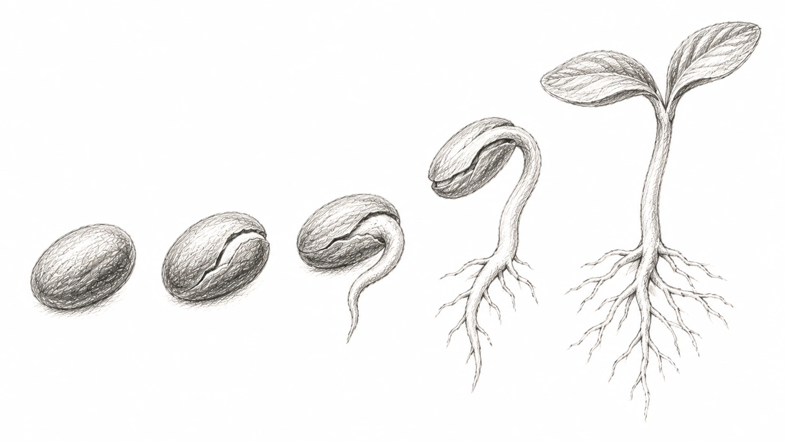

{fig-align="center" width="50%"}

#### We share our work so that you can figure out how to do it better.

::: {.columns}

::: {.column width="50%"}

## Research

Explore the methods behind our applied research, beginning with population
nowcasting for humanitarian response in Gaza.

[Explore research →](research/index.qmd)

:::

::: {.column width="50%"}

## Teaching

Learn practical statistical methods through accessible lectures, tutorials, and
worked examples.

[Start learning →](teaching/index.qmd)

:::

:::

## Open by design

Our work is intended to be transparent, reproducible, and adaptable. Alongside
these guides, you can explore our public data and source code.

- [Browse data →](https://data.realgoodresearch.com)
- [View our code on GitHub →](https://github.com/realgoodresearch)
- [Visit Real Good Research →](https://realgoodresearch.com)
