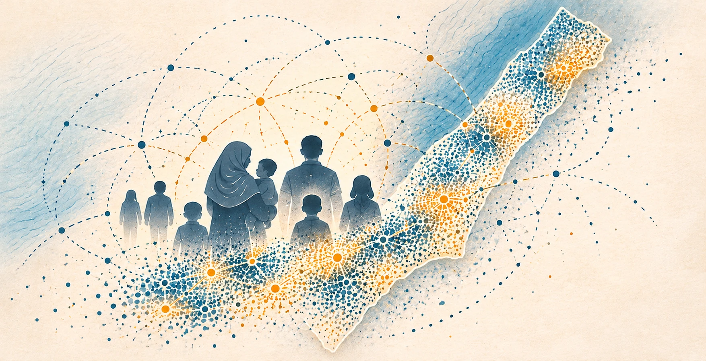

{fig-align="center" width="75%"}

The researchers of **Real Good Research** have been contributing to the international humanitarian response in Gaza since 7 October 2023 using innovative data sources to produce up-to-date population estimates with frequent updates for the smallest geographic areas possible. We initially transferred methods and data infrastructure that we developed to support the humanitarian response in Ukraine (see [Leasure et al. 2023](https://doi.org/10.1111/padr.12558)) by repurposing targeted advertising data from social media into a tool for targeted humanitarian assistance. You can read about some of our early work for Gaza from [Darin et al. (2026)](https://doi.org/10.1111/padr.70064) that further developed these methods and data. 

Since our initial work with social media targeted advertising data in Gaza, the data landscape has unsurprisingly changed, and we have been continuously working on methods that can help the humanitarian response adapt to these changes. This has included Bayesian mark-recapture methods to leverage polio vaccination data for estimation of child population sizes and vaccine coverage, demographic indirect estimation using privacy-preserving telecommunications data for population nowcasting, and machine learning for automated tent mapping from satellite imagery. 

Our aim with this collection of tutorials and documentation is to make these methods more accessible to you. We will walk you through some of the details and provide the source code so that you can reproduce and adapt the methods yourself. This is part of our vision for open-source innovation for humanitarian population nowcasting so that science can be harnessed and adapted more quickly to respond to crisis events. We hope you find these materials useful in your own work and that we can grow the community of researchers working together to improve these approaches.